# TÀI LIỆU THIẾT KẾ CƠ SỞ DỮ LIỆU (ER DIAGRAM & DATA MODEL)
**Hệ thống Quản lý và Đặt vé Máy bay (Airline Reservation System - ARS)**
**Mã tài liệu:** `docs/04-ER-Diagram.md`
**Dự án:** Aptech Airlines eProject
**Cơ sở dữ liệu:** MongoDB (`airline_db`) via Mongoose ODM
**Tình trạng:** Đồng bộ 100% từ mã nguồn Mongoose Schema thực tế

---

## 1. TỔNG QUAN KIẾN TRÚC DỮ LIỆU

Hệ thống **Aptech Airlines ARS** vận hành trên nền tảng **MongoDB** (Database: `airline_db`). Thay vì sử dụng mô hình quan hệ chuẩn hóa 3NF truyền thống vốn đòi hỏi nhiều phép kết nối (`JOIN`) phức tạp và tốn kém tài nguyên I/O, hệ thống áp dụng triết lý **Thiết kế hướng Tài liệu phi chuẩn hóa (Denormalized Document-Driven Design)**.

Mô hình này tối ưu hóa tối đa cho các nghiệp vụ đặc thù của ngành hàng không:
1. **Tra cứu chuyến bay với độ trễ siêu thấp (Low-latency Read):** Toàn bộ thông tin lịch trình, cấu hình máy bay và các khoang vé (`inventories`) được gói gọn trong cùng một tài liệu `Flight`, cho phép tìm kiếm hàng trăm chuyến bay chỉ với một thao tác đọc đĩa đơn lẻ.
2. **Cập nhật số lượng ghế khả dụng nguyên tử (Atomic Inventory Reservation):** Nhờ cơ chế khoá cấp tài liệu (Document-level Locking) của MongoDB và toán tử nguyên tử `$elemMatch` kết hợp `$inc`, việc trừ/cộng ghế diễn ra an toàn tuyệt đối mà không cần quản lý giao dịch phân tán phức tạp.
3. **Độc lập và bảo toàn lịch sử giao dịch (Transactional Snapshotting):** Mỗi đơn đặt vé `Booking` lưu trữ toàn bộ hành khách (`passengers`), các chặng vé (`ticket_coupons`), và lịch sử thanh toán (`payment_transactions`) dưới dạng mảng tài liệu con nhúng (embedded subdocuments), giúp bảo toàn tính toàn vẹn kiểm toán ngay cả khi thông tin chuyến bay hoặc giá vé cơ sở bị thay đổi trong tương lai.
4. **Phân bổ và định giá ghế ngồi động (Dynamic Seat Allocation & Additive Fee Stacking):** Collection `seatallocations` và `flightseatoverrides` đảm bảo tính toàn vẹn vật lý của từng vị trí ghế trên từng chuyến bay, trong khi `seatpricingrules` cấu hình 8 chiều định giá phụ phí ghế ngồi minh bạch.
5. **Đảm bảo tính nhất quán SAGA & Thanh toán Idempotent:** Collection `bookingseatsagaoperations` lưu vết trạng thái phối hợp SAGA hai pha (Two-phase forward recovery / compensation rollback) giữa kho vé thương mại và phân bổ ghế vật lý, và `paypalcheckoutsessions` quản lý máy trạng thái thanh toán trực tuyến idempotent.

---

## 2. SƠ ĐỒ THỰC THỂ - MỐI QUAN HỆ (MERMAID ER DIAGRAM)

Dưới đây là lược đồ dữ liệu thực tế trích xuất trực tiếp từ các Mongoose Schema trong mã nguồn Backend NestJS (`backend/src/**`):

```mermaid
erDiagram
    users ||--o{ bookings : "owns (user_id)"
    airports ||--o{ flights : "origin_iata"
    airports ||--o{ flights : "dest_iata"
    airports ||--o{ airports : "nearest_airport_code"
    flights ||--o{ ticket_coupons : "referenced by (flight_id)"
    flights ||--o{ seatallocations : "flight_id"
    flights ||--o{ flightseatoverrides : "flight_id"
    bookings ||--o{ seatallocations : "booking_id"
    users ||--o{ flightseatoverrides : "created_by_user_id"
    users ||--o{ seatpricingrules : "created_by_user_id"
    bookings ||--o{ bookingseatsagaoperations : "booking_id"

    users {
        ObjectId _id PK
        string username UK
        string password_hash
        string first_name
        string last_name
        string address
        string phone_number
        string email UK
        string sex
        number age
        string preferred_credit_card
        number sky_miles
        string role "CUSTOMER | CLERK | ADMIN | SUPER_ADMIN"
        Date createdAt
        Date updatedAt
    }

    airports {
        ObjectId _id PK
        string iata_code UK
        string city_name
        string airport_name
        boolean is_serviced_directly
        string nearest_airport_code FK
        number distance_to_nearest_km
        string time_zone
        string icao_code
        string country_code
        string city_code
        number lat
        number lng
        string data_source
        Date createdAt
        Date updatedAt
    }

    flights {
        ObjectId _id PK
        string flight_number
        string origin_iata FK
        string dest_iata FK
        string departure_date "YYYY-MM-DD"
        Date scheduled_departure
        Date scheduled_arrival
        Date actual_departure
        Date actual_arrival
        number duration_minutes "default 120"
        number distance_miles "default 0"
        string status "SCHEDULED | DELAYED | CANCELLED | COMPLETED"
        string delay_reason
        number delay_minutes
        string operator "default APTECH_AIRLINES"
        boolean is_bookable "default true"
        string data_source
        AircraftInfo aircraft "Embedded Object"
        FlightInventory inventories "Embedded Array"
        Date createdAt
        Date updatedAt
    }

    AircraftInfo {
        string model_code
        string model_name
        number total_capacity
        string registration
    }

    FlightInventory {
        ObjectId _id PK
        string cabin_class "ECONOMY | BUSINESS | FIRST | CLUB"
        boolean is_smoking
        string bucket_code
        number base_price
        number allocated_seats
        number available_seats
        InventorySagaMarker saga_markers "Embedded Array"
    }

    flights ||--o| AircraftInfo : "embeds 0..1"
    flights ||--|{ FlightInventory : "embeds 1..N"

    bookings {
        ObjectId _id PK
        string pnr_code UK
        ObjectId user_id FK
        string booking_type "ONE_WAY | ROUND_TRIP | CONNECTING"
        string status "BLOCKED | CONFIRMED | RESCHEDULED | CANCELLED"
        string blocking_number "UK (Sparse)"
        string confirmation_number "UK (Sparse)"
        string cancellation_number "UK (Sparse)"
        Date time_limit_deadline
        boolean is_reminder_sent
        number total_amount
        number total_fare
        number total_seat_fees
        number total_miles_accrued
        SeatSagaCommit seat_saga_commit "Embedded Object"
        Passenger passengers "Embedded Array"
        TicketCoupon ticket_coupons "Embedded Array"
        PaymentTransaction payment_transactions "Embedded Array"
        Date createdAt
        Date updatedAt
    }

    Passenger {
        string first_name
        string last_name
        string passenger_type "ADULT | CHILD | SENIOR"
        string id_card_or_passport
        string nationality
        Date date_of_birth
    }

    TicketCoupon {
        string coupon_number
        string passenger_name
        ObjectId flight_id FK
        string flight_number
        string inventory_id
        string cabin_class
        boolean is_smoking
        number fare_paid
        string seat_code
        string seat_selection_type "AUTO | CHOOSE"
        number seat_fee
        string seat_fee_currency
        object seat_pricing_snapshot
        string leg_type "OUTBOUND | INBOUND | CONNECTING_LEG"
        string coupon_status "ACTIVE | CANCELLED | RESCHEDULED"
    }

    PaymentTransaction {
        string payment_reference
        string source_payment_reference
        string transaction_type "PAYMENT | REFUND | RESCHEDULE_CHARGE | RESCHEDULE_REFUND"
        number amount
        string card_masked
        string currency
        string status "SUCCESS | PENDING | FAILED"
        string payment_method "PROFILE_CARD | PAYPAL"
        string payment_provider
        string provider_order_id
        string provider_capture_id
        string provider_refund_id
        string provider_amount
        string provider_currency
        number exchange_rate_vnd_per_unit
        string provider_status
        number retry_count
        Date next_retry_at
        string failure_reason
        Date created_at
    }

    bookings ||--|{ Passenger : "embeds 1..N"
    bookings ||--|{ TicketCoupon : "embeds 1..N"
    bookings ||--o{ PaymentTransaction : "embeds 0..N"

    seatallocations {
        ObjectId _id PK
        ObjectId flight_id FK
        string seat_code
        string status "HELD | CONFIRMED | BLOCKED_MAINTENANCE | CREW_REST | VIP_HOLD"
        string cabin_class "ECONOMY | BUSINESS | FIRST | CLUB"
        ObjectId booking_id FK
        string coupon_number
        string passenger_name
        string seat_selection_type "AUTO | CHOOSE"
        number passenger_index
        number seat_fee
        string seat_fee_currency
        object seat_pricing_snapshot
        string pricing_dimension_applied
        boolean is_free_selection
        Date held_until
        string saga_operation_id
        string allocation_batch_id
        string staff_block_reason
        ObjectId staff_blocked_by_user_id FK
        Date staff_blocked_at
        string staff_notes
        Date createdAt
        Date updatedAt
    }

    flightseatoverrides {
        ObjectId _id PK
        ObjectId flight_id FK
        string seat_code
        number override_fee
        string reason
        boolean is_active
        ObjectId created_by_user_id FK
        ObjectId deactivated_by_user_id FK
        Date deactivated_at
        Date createdAt
        Date updatedAt
    }

    seatpricingrules {
        ObjectId _id PK
        string rule_id UK
        string supersedes_rule_id
        number version
        boolean is_active
        string cabin_class "ECONOMY | BUSINESS | FIRST | CLUB | ALL"
        string pricing_dimension "CABIN_BASE | WINDOW | AISLE | MIDDLE | FRONT_ZONE | EXIT_ROW | EXTRA_LEGROOM | BULKHEAD"
        string position_subtype "WINDOW | AISLE | MIDDLE"
        number amount
        number priority
        Date effective_from
        Date effective_to
        ObjectId created_by_user_id FK
        ObjectId deactivated_by_user_id FK
        Date deactivated_at
        Date createdAt
        Date updatedAt
    }

    scheduletemplates {
        ObjectId _id PK
        string template_id UK
        string flight_number
        string origin_iata FK
        string dest_iata FK
        string std_dep_time
        string std_arr_time
        number[] days_of_week
        string aircraft_type
        string[] cabin_classes
        number base_price_economy
        number base_price_business
        number base_price_club
        number base_price_first
        boolean is_active
        CommercialInventoryConfig commercial_inventories
        string source_type
        string source_route_key
        string source_service_key
        Date createdAt
        Date updatedAt
    }

    paypalcheckoutsessions {
        ObjectId _id PK
        string checkout_id UK
        string client_request_id
        string user_id
        string operation_type "CREATE_BOOKING | CONFIRM_HOLD | RESCHEDULE"
        string status "CREATED | CAPTURING | CAPTURED | FINALIZING | COMPLETED | CANCELLED | STALE | PENDING | REFUNDED | FAILED | RECONCILE_REQUIRED"
        string paypal_order_id
        string paypal_capture_id
        string paypal_refund_id
        string provider_refund_id
        string provider_refund_status
        Date finalizing_started_at
        number amount_vnd
        string provider_amount
        string provider_currency
        number exchange_rate_vnd_per_unit
        object operation_payload
        string result_booking_id
        string result_confirmation_number
        string error_message
        string failure_reason
        Date order_expires_at
        Date createdAt
        Date updatedAt
    }

    bookingseatsagaoperations {
        ObjectId _id PK
        string operation_id UK
        string operation_type "CREATE | RESCHEDULE"
        ObjectId booking_id FK
        string state "PRECOMMIT | COMMITTED | COMPLETED | ABORTED"
        InventoryMutationEntry new_inventory_reservations
        InventoryMutationEntry old_inventory_restorations
        SeatAllocationRefEntry new_seat_allocations
        SeatAllocationRefEntry old_seat_allocations
        Date last_progress_at
        Date aborted_at
        Date completed_at
        string error
        Date createdAt
        Date updatedAt
    }

    cancellationpolicies {
        ObjectId _id PK
        number min_days_before
        number max_days_before "nullable"
        number refund_percentage
        string description
        string description_en
        Date createdAt
        Date updatedAt
    }
```



---

## 3. CHI TIẾT CẤU TRÚC DỮ LIỆU TỪNG COLLECTION

### 3.1. Collection: `users`
Lưu trữ toàn bộ thông tin tài khoản người dùng, bao gồm Hành khách (`CUSTOMER`), Nhân viên bán vé (`CLERK`), Quản trị viên (`ADMIN`), và Quản trị viên Tối cao (`SUPER_ADMIN`).

- **Tên Collection:** `users`
- **Tập tin Schema:** [users.schema.ts](../backend/src/users/users.schema.ts)
- **Chỉ mục (Indexes):**
  - `{ username: 1 }` (Unique)
  - `{ email: 1 }` (Unique)

| Tên trường | Kiểu dữ liệu | Bắt buộc | Mặc định | Ý nghĩa & Quy tắc nghiệp vụ |
| :--- | :--- | :---: | :--- | :--- |
| `_id` | `ObjectId` | Có | Auto | Khóa chính của bản ghi người dùng. |
| `username` | `string` | Có | - | Tên đăng nhập duy nhất, viết thường, cắt khoảng trắng. |
| `password_hash` | `string` | Có | - | Chuỗi mật khẩu băm bảo mật bằng thuật toán Bcrypt (Salt rounds = 10). |
| `first_name` | `string` | Có | - | Tên đệm và tên của người dùng. |
| `last_name` | `string` | Có | - | Họ của người dùng. |
| `address` | `string` | Không | `""` | Địa chỉ liên lạc. |
| `phone_number` | `string` | Không | `""` | Số điện thoại liên lạc. |
| `email` | `string` | Có | - | Địa chỉ email duy nhất (dùng nhận vé và thư nhắc giữ chỗ 3 tuần). |
| `sex` | `string` | Không | `"OTHER"` | Giới tính người dùng (`MALE`, `FEMALE`, `OTHER`). |
| `age` | `number` | Không | `0` | Tuổi người dùng. |
| `preferred_credit_card`| `string` | Không | `""` | Số thẻ tín dụng ưu tiên lưu trước để tự động điền khi thanh toán. |
| `sky_miles` | `number` | Không | `0` | Điểm dặm bay tích lũy (Yêu cầu 3.2: Khởi tạo mặc định bằng 0). |
| `role` | `string` | Có | `"CUSTOMER"`| Phân quyền: `CUSTOMER`, `CLERK`, `ADMIN`, `SUPER_ADMIN`. |
| `createdAt` | `Date` | Có | Now | Thời điểm tạo tài khoản (Mongoose timestamps: true). |
| `updatedAt` | `Date` | Có | Now | Thời điểm cập nhật tài khoản gần nhất. |

---

### 3.2. Collection: `airports`
Lưu trữ danh mục sân bay và thành phố phục vụ, hỗ trợ giải quyết nhập nhằng tên thành phố và gợi ý sân bay lân cận.

- **Tên Collection:** `airports`
- **Tập tin Schema:** [airports.schema.ts](../backend/src/airports/airports.schema.ts)
- **Chỉ mục (Indexes):**
  - `{ iata_code: 1 }` (Unique)
  - `{ city_name: 1 }`
  - `{ city_name: 1, is_serviced_directly: 1 }`
  - `{ is_serviced_directly: 1 }`
  - `{ country_code: 1 }`

| Tên trường | Kiểu dữ liệu | Bắt buộc | Mặc định | Ý nghĩa & Quy tắc nghiệp vụ |
| :--- | :--- | :---: | :--- | :--- |
| `_id` | `ObjectId` | Có | Auto | Khóa chính của bản ghi sân bay. |
| `iata_code` | `string` | Có | - | Mã sân bay 3 chữ cái chuẩn IATA (VD: `HAN`, `SGN`, `DAD`), viết hoa. |
| `city_name` | `string` | Có | - | Tên thành phố trực thuộc (VD: `Hà Nội`, `Hồ Chí Minh`, `Đà Nẵng`). |
| `airport_name` | `string` | Có | - | Tên đầy đủ của cảng hàng không (VD: `Nội Bài`, `Tân Sơn Nhất`). |
| `is_serviced_directly` | `boolean` | Không | `false` | Cờ xác định hãng có đường bay thẳng đến sân bay này hay không (Yêu cầu 3.3.1). |
| `nearest_airport_code` | `string` | Không | `""` | Mã IATA của sân bay gần nhất nếu hãng không khai thác bay thẳng tới đây. |
| `distance_to_nearest_km`| `number` | Không | `0` | Khoảng cách đường bộ (km) từ thành phố này đến sân bay gợi ý gần nhất. |
| `time_zone` | `string` | Không | `"UTC"` | Múi giờ địa phương (dùng tính toán chênh lệch múi giờ và thời gian bay). |
| `icao_code` | `string` | Không | - | Mã ICAO 4 chữ cái (VD: `VVTS`, `VVNB`). |
| `country_code` | `string` | Không | - | Mã quốc gia 2 ký tự (VD: `VN`, `JP`). |
| `city_code` | `string` | Không | - | Mã thành phố IATA. |
| `lat` | `number` | Không | - | Tọa độ vĩ độ (Latitude) thực tế của cảng hàng không. |
| `lng` | `number` | Không | - | Tọa độ kinh độ (Longitude) thực tế của cảng hàng không. |
| `data_source` | `string` | Không | `"ourairports"` | Nguồn dữ liệu tham chiếu sân bay. |
| `createdAt` | `Date` | Có | Now | Thời điểm tạo bản ghi. |
| `updatedAt` | `Date` | Có | Now | Thời điểm cập nhật bản ghi. |

---

### 3.3. Collection: `flights`
Lưu trữ lịch trình các chuyến bay thực tế, bao gồm thông tin tàu bay nhúng (`aircraft`) và mảng các khoang vé nhúng (`inventories`).

- **Tên Collection:** `flights`
- **Tập tin Schema:** [flights.schema.ts](../backend/src/flights/flights.schema.ts)
- **Chỉ mục (Indexes):**
  - `{ template_id: 1, operating_date: 1 }` (Unique, Sparse)
  - `{ flight_number: 1, departure_date: 1 }`
  - `{ origin_iata: 1, dest_iata: 1, departure_date: 1, status: 1 }`
  - `{ is_bookable: 1, origin_iata: 1, dest_iata: 1, departure_date: 1, status: 1 }`

| Tên trường | Kiểu dữ liệu | Bắt buộc | Mặc định | Ý nghĩa & Quy tắc nghiệp vụ |
| :--- | :--- | :---: | :--- | :--- |
| `_id` | `ObjectId` | Có | Auto | Khóa chính chuyến bay. |
| `flight_number` | `string` | Có | - | Số hiệu chuyến bay (VD: `VN101`, `VJ122`, `QH204`). |
| `origin_iata` | `string` | Có | - | Mã IATA sân bay cất cánh. |
| `dest_iata` | `string` | Có | - | Mã IATA sân bay hạ cánh. |
| `departure_date` | `string` | Có | - | Ngày khởi hành định dạng `YYYY-MM-DD` (phục vụ lọc chính xác theo ngày). |
| `scheduled_departure`| `Date` | Có | - | Thời gian cất cánh theo lịch trình (ISO Date). |
| `scheduled_arrival` | `Date` | Có | - | Thời gian hạ cánh theo lịch trình (ISO Date). |
| `actual_departure` | `Date` | Không | - | Thời gian cất cánh thực tế (khi có delay/sự cố). |
| `actual_arrival` | `Date` | Không | - | Thời gian hạ cánh thực tế. |
| `duration_minutes` | `number` | Có | `120` | Tổng thời gian bay tính theo phút (có xét múi giờ). |
| `distance_miles` | `number` | Có | `0` | Khoảng cách hành trình tính theo dặm mặt đất (Haversine Great Circle). Mặc định 0 nếu chưa xác định, không dùng số giả tạo. |
| `status` | `string` | Có | `"SCHEDULED"` | Trạng thái: `SCHEDULED`, `DELAYED`, `CANCELLED`, `COMPLETED`. |
| `delay_reason` | `string` | Không | `""` | Lý do chậm chuyến hoặc lý do khẩn cấp hủy chuyến do thời tiết xấu. |
| `delay_minutes` | `number` | Không | `0` | Số phút trễ chuyến bay. |
| `operator` | `string` | Có | `"APTECH_AIRLINES"` | Hãng vận hành chuyến bay. |
| `is_bookable` | `boolean` | Có | `true` | Cờ chuyến bay khả dụng cho hành khách đặt vé trực tuyến. |
| `data_source` | `string` | Không | `"INTERNAL_GENERATED"`| Nguồn dữ liệu chuyến bay (VD: `AIRLABS_COMMERCIALIZED`). |
| `aircraft` | `AircraftInfo` | Không | - | Tài liệu nhúng chứa thông tin tàu bay. |
| `inventories` | `FlightInventory[]` | Có | `[]` | Mảng tài liệu nhúng cấu hình các khoang vé và ghế khả dụng. |
| `createdAt` | `Date` | Có | Now | Thời điểm tạo chuyến bay. |
| `updatedAt` | `Date` | Có | Now | Thời điểm cập nhật thông tin chuyến bay. |

#### Tài liệu con nhúng: `AircraftInfo`
| Tên trường | Kiểu dữ liệu | Bắt buộc | Ý nghĩa & Quy tắc nghiệp vụ |
| :--- | :--- | :---: | :--- |
| `model_code` | `string` | Không | Mã ICAO của tàu bay (VD: `A20N`, `A21N`, `B789`, `A359`, `B738`, `AT76`). |
| `model_name` | `string` | Không | Tên hiển thị đầy đủ (VD: `Airbus A321neo`, `Boeing 787-9 Dreamliner`). |
| `total_capacity` | `number` | Không | Tổng sức chứa hành khách vật lý của toàn bộ tàu bay. |
| `registration` | `string` | Không | Số đăng bạ quốc tế (chỉ gán khi đã có kế hoạch bay thực tế, không sinh số ngẫu nhiên). |

#### Tài liệu con nhúng: `FlightInventory`
| Tên trường | Kiểu dữ liệu | Bắt buộc | Mặc định | Ý nghĩa & Quy tắc nghiệp vụ |
| :--- | :--- | :---: | :--- | :--- |
| `_id` | `ObjectId` | Có | Auto | Định danh duy nhất của khoang vé. |
| `cabin_class` | `string` | Có | - | Hạng khoang: `ECONOMY`, `BUSINESS`, `FIRST`, `CLUB`. |
| `is_smoking` | `boolean` | Không | `false` | Khoang cho phép hút thuốc hoặc không hút thuốc (Yêu cầu 3.3.4.1). |
| `bucket_code` | `string` | Không | `"Y"` | Mã hạng đặt chỗ nội bộ hàng không (Fare Bucket: `Y`, `J`, `F`). |
| `base_price` | `number` | Có | - | Giá vé cơ sở áp dụng cho 1 hành khách Người lớn (VND). |
| `allocated_seats` | `number` | Có | - | Tổng số ghế được phân bổ thương mại cho khoang vé này. |
| `available_seats` | `number` | Có | - | Số lượng ghế còn trống thương mại (giảm khi khách đặt CONFIRMED hoặc HELD). |
| `saga_markers` | `InventorySagaMarker[]`| Không | `[]` | Dấu vết khóa ghế trong giao dịch SAGA. |

---

### 3.4. Collection: `bookings`
Lưu trữ toàn bộ hồ sơ đặt chỗ (PNR), quản lý vòng đời từ Giữ chỗ (`BLOCKED`), Mua vé thành công (`CONFIRMED`), Đổi vé (`RESCHEDULED`) đến Hủy vé (`CANCELLED`).

- **Tên Collection:** `bookings`
- **Tập tin Schema:** [bookings.schema.ts](../backend/src/bookings/bookings.schema.ts)
- **Chỉ mục (Indexes):**
  - `{ pnr_code: 1 }` (Unique)
  - `{ user_id: 1 }` (Hỗ trợ tra cứu lịch sử đặt vé của hành khách)
  - `{ blocking_number: 1 }` (Unique, Sparse)
  - `{ confirmation_number: 1 }` (Unique, Sparse)
  - `{ cancellation_number: 1 }` (Unique, Sparse)

| Tên trường | Kiểu dữ liệu | Bắt buộc | Mặc định | Ý nghĩa & Quy tắc nghiệp vụ |
| :--- | :--- | :---: | :--- | :--- |
| `_id` | `ObjectId` | Có | Auto | Khóa chính của đơn đặt chỗ. |
| `pnr_code` | `string` | Có | - | Mã đặt chỗ tổng quan (6 ký tự ngẫu nhiên, tiền tố `PNR-`). |
| `user_id` | `ObjectId` | Có | - | Tham chiếu tới `_id` của tài khoản người dùng trong collection `users`. |
| `booking_type` | `string` | Có | `"ONE_WAY"` | Loại hành trình: `ONE_WAY`, `ROUND_TRIP`, `CONNECTING`. |
| `status` | `string` | Có | - | Trạng thái: `BLOCKED`, `CONFIRMED`, `RESCHEDULED`, `CANCELLED`. |
| `blocking_number` | `string` | Không | - | Mã giữ chỗ (tiền tố `BLK-`, chỉ sinh khi `status = BLOCKED`). |
| `confirmation_number` | `string` | Không | - | Mã xác nhận mua vé (tiền tố `CNF-`, chỉ sinh khi vé đã thanh toán). |
| `cancellation_number` | `string` | Không | - | Mã hủy vé (tiền tố `CAN-`, sinh khi vé bị hủy). |
| `time_limit_deadline` | `Date` | Không | - | Hạn chót thanh toán vé giữ chỗ (đúng bằng Ngày bay sớm nhất - 14 ngày). |
| `is_reminder_sent` | `boolean` | Không | `false` | Cờ ghi nhận hệ thống đã gửi email nhắc nhở 3 tuần trước ngày bay hay chưa. |
| `total_amount` | `number` | Có | `0` | Tổng số tiền vé của toàn bộ đoàn khách (`total_fare + total_seat_fees`). |
| `total_fare` | `number` | Có | `0` | Tổng giá cước vận chuyển cơ sở toàn đoàn. |
| `total_seat_fees` | `number` | Có | `0` | Tổng phụ phí chọn ghế ngồi toàn đoàn. |
| `total_miles_accrued` | `number` | Có | `0` | Tổng dặm bay SkyMiles tích lũy (bằng 0 nếu đang ở trạng thái BLOCKED). |
| `seat_saga_commit` | `SeatSagaCommit` | Không | - | Ghi nhận commit thành công của giao dịch SAGA kho ghế. |
| `passengers` | `Passenger[]` | Có | `[]` | Mảng thông tin định danh của từng hành khách trong đoàn bay. |
| `ticket_coupons` | `TicketCoupon[]` | Có | `[]` | Mảng chặng vé chi tiết tương ứng với mỗi hành khách trên mỗi chuyến bay. |
| `payment_transactions`| `PaymentTransaction[]` | Có | `[]` | Lịch sử các giao dịch tài chính (thanh toán, hoàn tiền, phụ thu đổi vé). |
| `early_bird_percent` | `number` | Không | - | Tỷ lệ giảm giá vé sớm nếu có. |
| `ff_tier` | `string` | Không | - | Hạng hội viên SkyMiles tại thời điểm đặt vé. |
| `ff_discount_percent` | `number` | Không | - | Mức giảm trừ quyền lợi hội viên áp dụng. |
| `createdAt` | `Date` | Có | Now | Thời điểm tạo hồ sơ đặt chỗ. |
| `updatedAt` | `Date` | Có | Now | Thời điểm cập nhật hồ sơ gần nhất. |

#### Tài liệu con nhúng: `Passenger`
| Tên trường | Kiểu dữ liệu | Bắt buộc | Mặc định | Ý nghĩa & Quy tắc nghiệp vụ |
| :--- | :--- | :---: | :--- | :--- |
| `first_name` | `string` | Có | - | Tên đệm và tên hành khách. |
| `last_name` | `string` | Có | - | Họ hành khách. |
| `passenger_type` | `string` | Có | `"ADULT"` | Phân loại hành khách: `ADULT` (100%), `CHILD` (75%), `SENIOR` (85%). |
| `id_card_or_passport`| `string` | Không | `""` | Số CMND/CCCD hoặc Hộ chiếu. |
| `nationality` | `string` | Không | `"Vietnamese"` | Quốc tịch hành khách. |
| `date_of_birth` | `Date` | Không | - | Ngày tháng năm sinh. |

#### Tài liệu con nhúng: `TicketCoupon`
| Tên trường | Kiểu dữ liệu | Bắt buộc | Mặc định | Ý nghĩa & Quy tắc nghiệp vụ |
| :--- | :--- | :---: | :--- | :--- |
| `coupon_number` | `string` | Có | - | Mã số vé điện tử định danh chặng bay (tiền tố `CPN-`). |
| `passenger_name` | `string` | Có | - | Họ tên đầy đủ của hành khách trên cuống vé. |
| `flight_id` | `ObjectId` | Có | - | Khóa ngoại tham chiếu đến chuyến bay trong collection `flights`. |
| `flight_number` | `string` | Có | - | Số hiệu chuyến bay (lưu snapshot tại thời điểm đặt). |
| `inventory_id` | `string` | Có | - | Định danh khoang vé đã đặt. |
| `cabin_class` | `string` | Có | - | Hạng khoang (`ECONOMY`, `BUSINESS`, `FIRST`, `CLUB`). |
| `is_smoking` | `boolean` | Không | `false` | Khoang hút thuốc hay không hút thuốc. |
| `fare_paid` | `number` | Có | - | Giá cước bay thực trả của riêng hành khách này trên chặng bay này. |
| `seat_code` | `string` | Không | `""` | Mã số ghế cụ thể trên tàu bay (VD: `15C`, `12A`). |
| `seat_selection_type`| `string` | Không | `"AUTO"` | Hình thức gán ghế: `AUTO` (tự động) hoặc `CHOOSE` (chọn thủ công). |
| `seat_fee` | `number` | Không | `0` | Phụ phí chọn ghế thực trả của chặng này. |
| `seat_fee_currency` | `string` | Không | `"VND"` | Đơn vị tiền tệ phụ phí ghế. |
| `seat_pricing_snapshot`| `object` | Không | - | Snapshot chi tiết các quy tắc tính phụ phí ghế. |
| `leg_type` | `string` | Có | `"OUTBOUND"`| Chiều chặng bay: `OUTBOUND`, `INBOUND`, `CONNECTING_LEG`. |
| `coupon_status` | `string` | Có | `"ACTIVE"` | Trạng thái chặng vé: `ACTIVE`, `CANCELLED`, `RESCHEDULED`. |

#### Tài liệu con nhúng: `PaymentTransaction`
| Tên trường | Kiểu dữ liệu | Bắt buộc | Mặc định | Ý nghĩa & Quy tắc nghiệp vụ |
| :--- | :--- | :---: | :--- | :--- |
| `payment_reference` | `string` | Không | - | Mã tham chiếu thanh toán nội bộ hệ thống. |
| `source_payment_reference`| `string` | Không | - | Mã tham chiếu giao dịch gốc khi hoàn tiền (REFUND). |
| `transaction_type` | `string` | Có | - | Phân loại: `PAYMENT`, `REFUND`, `RESCHEDULE_CHARGE`, `RESCHEDULE_REFUND`. |
| `amount` | `number` | Có | - | Số tiền giao dịch phát sinh. |
| `card_masked` | `string` | Không | - | Số thẻ tín dụng được che bảo mật (VD: `•••• •••• •••• 4444`). |
| `currency` | `string` | Không | `"VND"` | Đơn vị tiền tệ thanh toán. |
| `status` | `string` | Có | `"SUCCESS"` | Trạng thái giao dịch (`SUCCESS`, `PENDING`, `FAILED`). |
| `payment_method` | `string` | Không | - | Phương thức thanh toán: `PROFILE_CARD`, `PAYPAL`. |
| `payment_provider` | `string` | Không | - | Đơn vị cung cấp cổng thanh toán (VD: `PAYPAL`). |
| `provider_order_id`| `string` | Không | - | Mã đơn hàng sinh ra từ phía nhà cung cấp cổng thanh toán. |
| `provider_capture_id`| `string` | Không | - | Mã Capture thu tiền từ phía nhà cung cấp cổng thanh toán. |
| `provider_refund_id` | `string` | Không | - | Mã hoàn tiền từ phía nhà cung cấp cổng thanh toán. |
| `provider_amount` | `string` | Không | - | Số tiền ngoại tệ thực thanh toán tại nhà cung cấp (VD: `"100.00"`). |
| `provider_currency`| `string` | Không | - | Đơn vị ngoại tệ (VD: `"USD"`). |
| `exchange_rate_vnd_per_unit`| `number` | Không | - | Tỷ giá quy đổi VND/ngoại tệ tại thời điểm giao dịch. |
| `provider_status` | `string` | Không | - | Trạng thái phản hồi từ API nhà cung cấp. |
| `retry_count` | `number` | Không | `0` | Số lần thử lại xử lý giao dịch nền/đối soát. |
| `next_retry_at` | `Date` | Không | - | Thời điểm xếp lịch thử lại lần kế tiếp. |
| `failure_reason` | `string` | Không | - | Diễn giải lý do khi giao dịch thất bại. |
| `created_at` | `Date` | Có | Now | Thời điểm thực hiện giao dịch. |

---

### 3.5. Collection: `seatallocations`
Quản lý trạng thái và vòng đời vật lý của từng vị trí ghế ngồi trên từng chuyến bay cụ thể, hỗ trợ chọn chỗ, giữ chỗ, và khóa bảo dưỡng/nghỉ ngơi phi hành đoàn.

- **Tên Collection:** `seatallocations`
- **Tập tin Schema:** [seat-allocation.schema.ts](../backend/src/seat-allocation/seat-allocation.schema.ts)
- **Chỉ mục (Indexes):**
  - `{ flight_id: 1, seat_code: 1 }` (Unique compound index)
  - `{ booking_id: 1, coupon_number: 1 }` (Unique partial: `booking_id`, `coupon_number` exist)
  - `{ flight_id: 1, status: 1 }`
  - `{ booking_id: 1 }`
  - `{ held_until: 1 }`

| Tên trường | Kiểu dữ liệu | Bắt buộc | Mặc định | Ý nghĩa & Quy tắc nghiệp vụ |
| :--- | :--- | :---: | :--- | :--- |
| `_id` | `ObjectId` | Có | Auto | Khóa chính bản ghi phân bổ ghế. |
| `flight_id` | `ObjectId` | Có | - | Khóa ngoại tham chiếu đến chuyến bay `flights._id`. |
| `seat_code` | `string` | Có | - | Mã vị trí ghế vật lý (VD: `15C`, `01A`). |
| `status` | `string` | Có | `"HELD"` | Trạng thái vật lý chuẩn: `HELD`, `CONFIRMED`, `BLOCKED_MAINTENANCE`, `CREW_REST`, `VIP_HOLD`. (Tuyệt đối không có trạng thái AVAILABLE hay OCCUPIED). |
| `cabin_class` | `string` | Có | - | Hạng khoang: `ECONOMY`, `BUSINESS`, `FIRST`, `CLUB`. |
| `booking_id` | `ObjectId` | Không | - | Tham chiếu đến đơn vé sở hữu ghế (khi HELD hoặc CONFIRMED). |
| `coupon_number` | `string` | Không | - | Mã số cuống vé tương ứng gắn với ghế này. |
| `passenger_name` | `string` | Không | - | Họ tên hành khách ngồi tại ghế. |
| `seat_selection_type`| `string` | Không | - | Loại chọn ghế: `AUTO` hoặc `CHOOSE`. |
| `passenger_index` | `number` | Không | - | Chỉ số thứ tự hành khách trong đoàn bay (0-indexed). |
| `seat_fee` | `number` | Không | `0` | Phụ phí chọn ghế áp dụng. |
| `seat_fee_currency` | `string` | Không | `"VND"` | Đơn vị tiền tệ phụ phí ghế. |
| `seat_pricing_snapshot`| `object` | Không | - | Snapshot chi tiết các quy tắc tính phụ phí ghế. |
| `pricing_dimension_applied`| `string` | Không | - | Chiều định giá cụ thể được kích hoạt. |
| `is_free_selection` | `boolean` | Không | `false` | Cờ ghế miễn phí theo chính sách hạng vé/hội viên. |
| `held_until` | `Date` | Không | - | Thời hạn hết hạn giữ chỗ (cho trạng thái HELD). |
| `saga_operation_id` | `string` | Không | - | Mã định danh phiên SAGA đang kiểm soát việc gán ghế. |
| `allocation_batch_id`| `string` | Không | - | Mã định danh lô phân bổ ghế. |
| `staff_block_reason`| `string` | Không | - | Lý do nhân viên khóa ghế vật lý. |
| `staff_blocked_by_user_id`| `ObjectId`| Không | - | Người thực hiện lệnh khóa ghế vật lý. |
| `staff_blocked_at` | `Date` | Không | - | Thời điểm nhân viên khóa ghế vật lý. |
| `staff_notes` | `string` | Không | - | Ghi chú vận hành của nhân viên. |
| `createdAt` | `Date` | Có | Now | Thời điểm tạo bản ghi phân bổ. |
| `updatedAt` | `Date` | Có | Now | Thời điểm cập nhật trạng thái phân bổ. |

---

### 3.6. Collection: `flightseatoverrides`
Ghi nhận các can thiệp giá vé bất biến cấp chuyến bay hoặc khóa ghế đặc thù của nhân viên quản trị.

- **Tên Collection:** `flightseatoverrides`
- **Tập tin Schema:** [flight-seat-override.schema.ts](../backend/src/seat-allocation/flight-seat-override.schema.ts)
- **Chỉ mục (Indexes):**
  - `{ flight_id: 1, seat_code: 1 }` (Unique, `partialFilterExpression: { is_active: true }`)
  - `{ flight_id: 1, is_active: 1 }`

| Tên trường | Kiểu dữ liệu | Bắt buộc | Mặc định | Ý nghĩa & Quy tắc nghiệp vụ |
| :--- | :--- | :---: | :--- | :--- |
| `_id` | `ObjectId` | Có | Auto | Khóa chính bản ghi override ghế. |
| `flight_id` | `ObjectId` | Có | - | Tham chiếu đến chuyến bay `flights._id`. |
| `seat_code` | `string` | Có | - | Mã số ghế được can thiệp giá. |
| `override_fee` | `number` | Có | - | Mức phụ thu ghi đè cố định cho riêng vị trí ghế trên chuyến này (VND). |
| `reason` | `string` | Có | - | Lý do nghiệp vụ can thiệp phụ thu ghế. |
| `is_active` | `boolean` | Có | `true` | Đánh dấu bản ghi đang có hiệu lực. |
| `created_by_user_id`| `ObjectId`| Có | - | ID quản trị viên thiết lập override (Audit trail bắt buộc). |
| `deactivated_by_user_id`| `ObjectId`| Không | - | Quản trị viên hủy hiệu lực override. |
| `deactivated_at` | `Date` | Không | - | Thời điểm hủy hiệu lực override. |
| `createdAt` | `Date` | Có | Now | Thời điểm tạo bản ghi. |
| `updatedAt` | `Date` | Có | Now | Thời điểm cập nhật bản ghi. |

---

### 3.7. Collection: `seatpricingrules`
Cấu hình động 8 chiều định giá phụ thu ghế ngồi độc lập theo mô hình cộng dồn minh bạch (Additive Fee Stacking) và phiên bản hóa bất biến (`supersedes_rule_id` + `version`).

- **Tên Collection:** `seatpricingrules`
- **Tập tin Schema:** [seat-pricing-rule.schema.ts](../backend/src/seat-allocation/seat-pricing-rule.schema.ts)
- **Chỉ mục (Indexes):**
  - `{ cabin_class: 1, pricing_dimension: 1, is_active: 1, priority: -1 }`

| Tên trường | Kiểu dữ liệu | Bắt buộc | Mặc định | Ý nghĩa & Quy tắc nghiệp vụ |
| :--- | :--- | :---: | :--- | :--- |
| `_id` | `ObjectId` | Có | Auto | Khóa chính quy tắc giá ghế. |
| `rule_id` | `string` | Có | - | Mã định danh duy nhất của quy tắc (VD: `RULE_WINDOW_ECO_01`). |
| `supersedes_rule_id`| `string` | Không | - | Mã quy tắc tiền nhiệm khi nâng cấp phiên bản bất biến. |
| `version` | `number` | Có | `1` | Số thứ tự phiên bản của quy tắc (bắt đầu từ 1). |
| `is_active` | `boolean` | Có | `true` | Trạng thái kích hoạt của quy tắc. |
| `cabin_class` | `string` | Có | - | Khoang vé áp dụng (`ECONOMY`, `BUSINESS`, `FIRST`, `CLUB`, hoặc `'ALL'`). |
| `pricing_dimension` | `string` | Có | - | 1 trong 8 chiều giá: `CABIN_BASE`, `WINDOW`, `AISLE`, `MIDDLE`, `FRONT_ZONE`, `EXIT_ROW`, `EXTRA_LEGROOM`, `BULKHEAD`. |
| `position_subtype` | `string` | Không | - | Phân loại vị trí phụ (`WINDOW`, `AISLE`, `MIDDLE`). |
| `amount` | `number` | Có | - | Mức tiền phụ thu danh định (VND, trường mã nguồn: `amount`, không dùng `amount_vnd`). |
| `priority` | `number` | Có | `0` | Độ ưu tiên thực thi quy tắc. |
| `effective_from` | `Date` | Có | Now | Thời điểm bắt đầu có hiệu lực. |
| `effective_to` | `Date` | Không | - | Thời điểm kết thúc hiệu lực. |
| `created_by_user_id`| `ObjectId`| Có | - | Quản trị viên khởi tạo quy tắc. |
| `deactivated_by_user_id`| `ObjectId`| Không | - | Quản trị viên vô hiệu hóa quy tắc. |
| `deactivated_at` | `Date` | Không | - | Thời điểm quy tắc bị vô hiệu hóa. |
| `createdAt` | `Date` | Có | Now | Thời điểm tạo bản ghi. |
| `updatedAt` | `Date` | Có | Now | Thời điểm cập nhật bản ghi. |

---

### 3.8. Collection: `scheduletemplates`
Lưu trữ khung lịch bay thương mại mẫu định kỳ theo ngày trong tuần, phục vụ tự động vật chất hóa (materialize) các chuyến bay cụ thể trong chân trời 330 ngày.

- **Tên Collection:** `scheduletemplates`
- **Tập tin Schema:** [schedule-template.schema.ts](../backend/src/flights/schemas/schedule-template.schema.ts)
- **Chỉ mục (Indexes):**
  - `{ origin_iata: 1, dest_iata: 1 }`
  - `{ is_active: 1 }`
  - `{ source_type: 1 }`
  - `{ source_service_key: 1 }` (Sparse)
  - `{ source_route_key: 1 }` (Sparse)

| Tên trường | Kiểu dữ liệu | Bắt buộc | Mặc định | Ý nghĩa & Quy tắc nghiệp vụ |
| :--- | :--- | :---: | :--- | :--- |
| `_id` | `ObjectId` | Có | Auto | Khóa chính lịch bay mẫu. |
| `template_id` | `string` | Có | - | Mã mẫu lịch trình duy nhất (VD: `APT-HAN-SGN-01`). |
| `flight_number` | `string` | Có | - | Số hiệu chuyến bay thương mại (VD: `APT201`). |
| `origin_iata` | `string` | Có | - | Mã IATA sân bay xuất phát (3 ký tự). |
| `dest_iata` | `string` | Có | - | Mã IATA sân bay đến (3 ký tự). |
| `std_dep_time` | `string` | Không | - | Giờ khởi hành chuẩn địa phương định dạng `HH:mm`. |
| `std_arr_time` | `string` | Không | - | Giờ hạ cánh chuẩn địa phương định dạng `HH:mm`. |
| `days_of_week` | `number[]` | Có | - | Mảng các ngày bay trong tuần (1 = Thứ Hai, ..., 7 = Chủ Nhật). |
| `aircraft_type` | `string` | Có | - | Loại tàu bay khai thác (`A20N`, `A21N`, `B789`, `A359`, `B738`, `AT76`). |
| `cabin_classes` | `string[]` | Có | - | Danh sách các hạng khoang vé cấu hình trên mẫu lịch. |
| `base_price_economy`| `number` | Có | - | Giá vé cơ sở khoang Economy (VND). |
| `base_price_business`| `number`| Không | - | Giá vé cơ sở khoang Business (VND). |
| `base_price_club` | `number` | Không | - | Giá vé cơ sở khoang Club/Premium Economy (VND). |
| `base_price_first`| `number` | Không | - | Giá vé cơ sở khoang First Class (nếu có). |
| `is_active` | `boolean` | Có | `true` | Trạng thái kích hoạt khai thác thương mại của mẫu lịch. |
| `commercial_inventories`| `CommercialInventoryConfig[]`| Không | `[]` | Cấu hình phân bổ ghế thương mại theo khoang. |
| `source_type` | `string` | Có | `"LEGACY_SYNTHETIC"`| Nguồn dữ liệu tạo mẫu: `AIRLABS`, `LEGACY_SYNTHETIC`, `MANUAL`. |
| `source_route_key`| `string` | Không | - | Khóa tham chiếu tuyến bay AirLabs bất biến. |
| `source_service_key`| `string`| Không | - | Nhóm dịch vụ chuyến bay ổn định. |
| `createdAt` | `Date` | Có | Now | Thời điểm tạo bản ghi. |
| `updatedAt` | `Date` | Có | Now | Thời điểm cập nhật bản ghi. |

---

### 3.9. Collection: `paypalcheckoutsessions`
Quản lý các phiên thanh toán trực tuyến PayPal Phase 1B, bảo đảm tính bất biến tài chính, đối soát giao dịch và hoàn tiền bồi hoàn an toàn khi phát sinh lỗi hệ thống.

- **Tên Collection:** `paypalcheckoutsessions`
- **Tập tin Schema:** [paypal-checkout.schema.ts](../backend/src/paypal/paypal-checkout.schema.ts)
- **Chỉ mục (Indexes):**
  - `{ user_id: 1, client_request_id: 1, operation_type: 1 }` (Unique compound index)
  - `{ checkout_id: 1 }` (Unique)
  - `{ status: 1 }`
  - `{ paypal_order_id: 1 }` (Sparse)

| Tên trường | Kiểu dữ liệu | Bắt buộc | Mặc định | Ý nghĩa & Quy tắc nghiệp vụ |
| :--- | :--- | :---: | :--- | :--- |
| `_id` | `ObjectId` | Có | Auto | Khóa chính phiên thanh toán. |
| `checkout_id` | `string` | Có | - | Mã phiên định danh độc nhất (VD: `CHK-1727...`). |
| `client_request_id`| `string` | Có | - | Khóa Idempotency phía client gửi lên chống trùng lặp. |
| `user_id` | `string` | Có | - | ID người dùng thực hiện thanh toán. |
| `operation_type` | `string` | Có | - | Loại giao dịch: `CREATE_BOOKING`, `CONFIRM_HOLD`, `RESCHEDULE`. |
| `status` | `string` | Có | `"CREATED"` | Trạng thái phiên: `CREATED`, `CAPTURING`, `CAPTURED`, `FINALIZING`, `COMPLETED`, `CANCELLED`, `STALE`, `PENDING`, `REFUNDED`, `FAILED`, `RECONCILE_REQUIRED`. |
| `paypal_order_id` | `string` | Không | - | Mã đơn hàng sinh ra từ PayPal API (`ORDERS-V2`). |
| `paypal_capture_id`| `string` | Không | - | Mã Capture thu tiền từ PayPal. |
| `paypal_refund_id` | `string` | Không | - | Mã hoàn tiền từ PayPal. |
| `provider_refund_id`| `string`| Không | - | Mã hoàn tiền nhà cung cấp. |
| `provider_refund_status`| `string`| Không | - | Trạng thái hoàn tiền từ nhà cung cấp. |
| `finalizing_started_at`| `Date`| Không | - | Thời điểm bắt đầu hoàn tất đơn hàng. |
| `amount_vnd` | `number` | Có | - | Số tiền thanh toán theo đồng Việt Nam (VND). |
| `provider_amount` | `string` | Có | - | Số tiền ngoại tệ thực thanh toán tại nhà cung cấp (VD: `"100.00"`). |
| `provider_currency`| `string` | Có | `"USD"` | Đơn vị ngoại tệ. |
| `exchange_rate_vnd_per_unit`| `number`| Có | - | Tỷ giá quy đổi VND/ngoại tệ tại thời điểm snapshot. |
| `operation_payload`| `object` | Không | - | Dữ liệu ngữ cảnh nghiệp vụ chuyến bay/đổi vé. |
| `result_booking_id`| `string` | Không | - | ID đơn đặt vé tạo thành công sau thanh toán. |
| `result_confirmation_number`| `string`| Không | - | Số xác nhận CNF tạo thành công. |
| `error_message` | `string` | Không | - | Thông báo lỗi khi xảy ra sự cố. |
| `failure_reason` | `string` | Không | - | Diễn giải nguyên nhân thất bại. |
| `order_expires_at` | `Date` | Không | - | Thời điểm hết hạn phiên thanh toán PayPal. |
| `createdAt` | `Date` | Có | Now | Thời điểm khởi tạo phiên thanh toán. |
| `updatedAt` | `Date` | Có | Now | Thời điểm cập nhật phiên thanh toán. |

---

### 3.10. Collection: `bookingseatsagaoperations`
Lưu vết trạng thái phối hợp SAGA hai pha (Two-phase forward recovery / compensation rollback) giữa kho vé thương mại và phân bổ ghế vật lý.

- **Tên Collection:** `bookingseatsagaoperations`
- **Tập tin Schema:** [booking-seat-saga-operation.schema.ts](../backend/src/seat-allocation/booking-seat-saga-operation.schema.ts)
- **Chỉ mục (Indexes):**
  - `{ operation_id: 1 }` (Unique)
  - `{ booking_id: 1 }`
  - `{ state: 1, last_progress_at: 1 }`

| Tên trường | Kiểu dữ liệu | Bắt buộc | Mặc định | Ý nghĩa & Quy tắc nghiệp vụ |
| :--- | :--- | :---: | :--- | :--- |
| `_id` | `ObjectId` | Có | Auto | Khóa chính bản ghi phiên SAGA. |
| `operation_id` | `string` | Có | - | Mã định danh phiên SAGA (tiền tố `SAGA-`). |
| `operation_type` | `string` | Có | - | Loại phiên SAGA: `CREATE` hoặc `RESCHEDULE`. |
| `booking_id` | `ObjectId` | Có | - | Tham chiếu đến đơn vé liên quan. |
| `state` | `string` | Có | `"PRECOMMIT"`| Trạng thái máy SAGA: `PRECOMMIT`, `COMMITTED`, `COMPLETED`, `ABORTED`. |
| `new_inventory_reservations`| `InventoryMutationEntry[]`| Có | `[]` | Danh sách khoang vé mới cần trừ ghế. |
| `old_inventory_restorations`| `InventoryMutationEntry[]`| Có | `[]` | Danh sách khoang vé cũ cần hoàn ghế khi đổi vé. |
| `new_seat_allocations`| `SeatAllocationRefEntry[]`| Có | `[]` | Danh sách ghế vật lý mới phân bổ. |
| `old_seat_allocations`| `SeatAllocationRefEntry[]`| Có | `[]` | Danh sách ghế vật lý cũ giải phóng khi đổi vé. |
| `last_progress_at` | `Date` | Có | Now | Thời điểm cập nhật tiến trình gần nhất. |
| `aborted_at` | `Date` | Không | - | Thời điểm hủy bỏ và bồi hoàn phiên SAGA. |
| `completed_at` | `Date` | Không | - | Thời điểm hoàn tất trọn vẹn phiên SAGA. |
| `error` | `string` | Không | - | Chi tiết lỗi nếu xảy ra sự cố. |
| `createdAt` | `Date` | Có | Now | Thời điểm tạo bản ghi. |
| `updatedAt` | `Date` | Có | Now | Thời điểm cập nhật bản ghi. |

---

### 3.11. Collection: `cancellationpolicies`
Lưu trữ các mốc thời gian quy định tỷ lệ phần trăm tiền vé được hoàn lại khi hành khách chủ động hủy vé đã xác nhận (`CONFIRMED`).

- **Tên Collection:** `cancellationpolicies`
- **Tập tin Schema:** [policies.schema.ts](../backend/src/policies/policies.schema.ts)
- **Chỉ mục (Indexes):** Không có chỉ mục đặc biệt (dữ liệu cấu hình số lượng ít, tải toàn bộ khi kiểm tra).

| Tên trường | Kiểu dữ liệu | Bắt buộc | Mặc định | Ý nghĩa & Quy tắc nghiệp vụ |
| :--- | :--- | :---: | :--- | :--- |
| `_id` | `ObjectId` | Có | Auto | Khóa chính quy tắc chính sách. |
| `min_days_before` | `number` | Có | - | Số ngày tối thiểu trước ngày khởi hành để áp dụng mức hoàn này. |
| `max_days_before` | `number` | Không | `null` | Số ngày tối đa trước ngày khởi hành (`null` biểu thị không giới hạn trần). |
| `refund_percentage`| `number` | Có | - | Tỷ lệ hoàn tiền (%) cho phép (từ 0 đến 100). |
| `description` | `string` | Có | - | Diễn giải chi tiết bằng tiếng Việt về điều kiện hoàn vé. |
| `description_en` | `string` | Không | - | Diễn giải chi tiết bằng tiếng Anh. |
| `createdAt` | `Date` | Có | Now | Thời điểm tạo quy tắc. |
| `updatedAt` | `Date` | Có | Now | Thời điểm cập nhật quy tắc. |

---

## 4. SO SÁNH GIỮA THIẾT KẾ PHI CHUẨN HÓA (MONGODB) VÀ THIẾT KẾ CHUẨN HÓA GỐC (3NF - DRAW.IO)

Trong hồ sơ thiết kế ban đầu (`downloaded_db_file` - sơ đồ chuẩn hóa 3NF vẽ trên Draw.io/PlantUML), hệ thống được thiết kế theo tư duy Cơ sở dữ liệu quan hệ (RDBMS) gồm 11 bảng tách biệt:

```
[airports] ──(FK)──> [routes] ──(FK)──> [flight_instances] ──(FK)──> [flight_inventories]
                                                                             │
[users] ──(FK)──> [bookings] ──(FK)──> [booking_passengers] ──(FK)──> [ticket_coupons]
                      │
                      └──(FK)──> [payment_transactions]
[cancellation_rules]
[aircraft_types] ──(FK)──> [flight_instances]
```

### 4.1. Bảng ánh xạ Chuyển đổi Thực thể

| Bảng quan hệ gốc (RDBMS 3NF) | Thực thể tương ứng trong MongoDB (`airline_db`) | Phương pháp chuyển đổi & Vị trí lưu trữ |
| :--- | :--- | :--- |
| `airports` | `airports` collection | Giữ nguyên dạng collection độc lập do tính tái sử dụng cao. |
| `aircraft_types` | `flights.aircraft` | Nhúng trực tiếp (`Embedded Object`) vào document chuyến bay. |
| `routes` | Các trường trong `flights` (`origin_iata`, `dest_iata`, `duration_minutes`, `distance_miles`) | Gộp thẳng vào tài liệu chuyến bay cụ thể, loại bỏ bảng tuyến bay tĩnh. |
| `flight_instances` | `flights` collection | Trở thành Document gốc của toàn bộ thực thể chuyến bay. |
| `flight_inventories` | `flights.inventories[]` | Nhúng dưới dạng Mảng tài liệu con (`Embedded Array`) trong `flights`. |
| `users` | `users` collection | Giữ nguyên collection độc lập quản lý xác thực và phân quyền. |
| `bookings` | `bookings` collection | Trở thành Document gốc của toàn bộ hồ sơ giao dịch đặt chỗ (PNR). |
| `booking_passengers` | `bookings.passengers[]` | Nhúng thành Mảng tài liệu con bên trong tài liệu `bookings`. |
| `ticket_coupons` | `bookings.ticket_coupons[]` | Nhúng thành Mảng tài liệu con chứa mã vé, giá thực trả, ghế ngồi. |
| `cancellation_rules` | `cancellationpolicies` collection | Giữ nguyên collection độc lập để Admin dễ dàng tinh chỉnh chính sách. |
| `payment_transactions` | `bookings.payment_transactions[]` | Nhúng thành Mảng tài liệu con ghi vết giao dịch thanh toán & hoàn tiền. |

---

### 4.2. Tại sao MongoDB sử dụng cấu trúc Nhúng (Embedded Documents)?

1. **Tối ưu hóa Truy vấn Đọc Đơn Lẻ (Single-Document Reads for High Concurrency Search):**
   - Trong mô hình 3NF, để hiển thị 1 kết quả tìm kiếm chuyến bay kèm giá vé và ghế trống, hệ thống RDBMS phải thực hiện `JOIN` qua 4 bảng: `routes` ⨝ `flight_instances` ⨝ `aircraft_types` ⨝ `flight_inventories`. Khi có hàng ngàn hành khách cùng tra cứu giờ cao điểm, các câu lệnh JOIN này gây nghẽn cổ chai CPU và I/O đĩa.
   - Với MongoDB, toàn bộ thông tin khoang vé, giá vé và số ghế trống nằm ngay trong một Document `Flight`. Một phép tìm kiếm đơn giản với chỉ mục `{ origin_iata: 1, dest_iata: 1, departure_date: 1 }` sẽ trả về dữ liệu hoàn chỉnh chỉ với **duy nhất 1 thao tác đọc đĩa (1 Single-Document Read)**.
2. **Thao tác Giữ chỗ & Đặt vé Nguyên tử (Atomic Inventory Updates):**
   - Đặt vé máy bay đòi hỏi phải trừ số ghế trống (`available_seats`) một cách nguyên tử để chống bán vượt quá số ghế (overbooking).
   - MongoDB hỗ trợ cập nhật nguyên tử ở cấp độ Document mà không cần bật Multi-Document Transactions:
     ```typescript
     this.flightModel.findOneAndUpdate(
       {
         _id: flightId,
         inventories: { $elemMatch: { _id: inventoryId, available_seats: { $gte: count } } }
       },
       { $inc: { 'inventories.$.available_seats': -count } },
       { new: true }
     )
     ```
     Lệnh trên vừa kiểm tra điều kiện ghế trống đủ số lượng vừa trừ số ghế trong đúng 1 bước nguyên tử của engine WiredTiger.
3. **Bảo tồn Lịch sử Bất biến (Immutable Audit Snapshotting):**
   - Giá vé cơ sở của chuyến bay có thể tăng/giảm theo thuật toán giá động. Nếu lưu quan hệ trỏ khóa ngoại về `flight_inventories`, khi giá vé cơ sở thay đổi, hóa đơn cũ của khách hàng sẽ bị tính sai.
   - Nhúng `fare_paid` vào `ticket_coupons` bên trong `Booking` cho phép đóng băng (snapshot) chính xác số tiền khách đã trả tại thời điểm giao dịch thành công.

---

### 4.3. Đánh giá Sự đánh đổi Kỹ thuật (Architectural Trade-offs)

| Tiêu chí | Mô hình Chuẩn hóa Ban đầu (RDBMS 3NF) | Mô hình Nhúng Phi chuẩn hóa (MongoDB Thực tế) |
| :--- | :--- | :--- |
| **Hiệu năng Đọc (Read Performance)** | Kém hơn do phải JOIN nhiều bảng quan hệ phức tạp. | **Cực nhanh (O(1) trên Document đơn lẻ đã lập chỉ mục).** |
| **Tính Toàn vẹn Dữ liệu (Integrity)** | RDBMS engine đảm bảo qua ràng buộc Khóa ngoại (Foreign Keys). | Phụ thuộc vào Application Layer (NestJS Services & Mongoose Validators). |
| **Cập nhật Thông tin Dùng chung** | Dễ dàng: Sửa tên loại máy bay tại 1 dòng của bảng `aircraft_types`. | Chấp nhận dư thừa dữ liệu: Phải duyệt qua các chuyến bay để cập nhật lại nếu cần. |
| **Độ phức tạp Giao dịch (Transactions)** | Hỗ trợ ACID đa bảng sẵn có nhưng tốn chi phí lock. | Tận dụng Document-level Atomicity, không cần mở session transaction nặng nề. |
| **Khả năng Mở rộng Ngang (Horizontal Scaling)** | Khó phân mảnh (Sharding) khi có quá nhiều bảng ràng buộc khóa ngoại chéo. | **Dễ dàng Sharding theo khóa `origin_iata` hoặc `departure_date`.** |

**Kết luận:** Kiến trúc dữ liệu MongoDB thực tế được lựa chọn phản ánh đúng tiêu chuẩn thiết kế phần mềm hiện đại cho hệ thống đặt chỗ trực tuyến: đánh đổi một phần tính chuẩn hóa dữ liệu tĩnh để đổi lấy tốc độ truy vấn vượt trội, khả năng chịu tải cao và thao tác đặt chỗ nguyên tử an toàn tuyệt đối.
