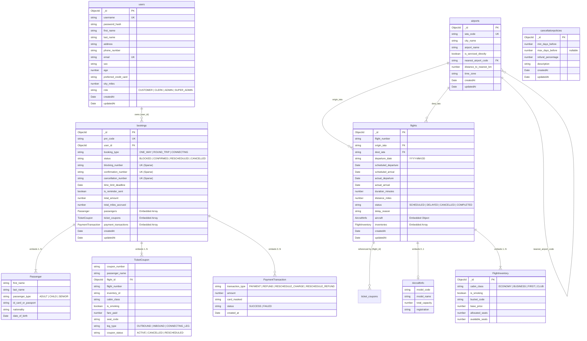

# TÀI LIỆU THIẾT KẾ CƠ SỞ DỮ LIỆU (ER DIAGRAM & DATA MODEL)
**Hệ thống Quản lý và Đặt vé Máy bay (Airline Reservation System - ARS)**
**Mã tài liệu:** `docs/04-ER-Diagram.md`
**Dự án:** Aptech Airlines eProject
**Cơ sở dữ liệu:** MongoDB (`airline_db`) via Mongoose ODM

---

## 1. TỔNG QUAN KIẾN TRÚC DỮ LIỆU

Hệ thống **Aptech Airlines ARS** vận hành trên nền tảng **MongoDB** (Database: `airline_db`). Thay vì sử dụng mô hình quan hệ chuẩn hóa 3NF truyền thống vốn đòi hỏi nhiều phép kết nối (`JOIN`) phức tạp và tốn kém tài nguyên I/O, hệ thống áp dụng triết lý **Thiết kế hướng Tài liệu phi chuẩn hóa (Denormalized Document-Driven Design)**.

Mô hình này tối ưu hóa tối đa cho các nghiệp vụ đặc thù của ngành hàng không:
1. **Tra cứu chuyến bay với độ trễ siêu thấp (Low-latency Read):** Toàn bộ thông tin lịch trình, cấu hình máy bay và các khoang vé (`inventories`) được gói gọn trong cùng một tài liệu `Flight`, cho phép tìm kiếm hàng trăm chuyến bay chỉ với một thao tác đọc đĩa đơn lẻ.
2. **Cập nhật số lượng ghế khả dụng nguyên tử (Atomic Inventory Reservation):** Nhờ cơ chế khoá cấp tài liệu (Document-level Locking) của MongoDB và toán tử nguyên tử `$elemMatch` kết hợp `$inc`, việc trừ/cộng ghế diễn ra an toàn tuyệt đối mà không cần quản lý giao dịch phân tán phức tạp.
3. **Độc lập và bảo toàn lịch sử giao dịch (Transactional Snapshotting):** Mỗi đơn đặt vé `Booking` lưu trữ toàn bộ hành khách (`passengers`), các chặng vé (`ticket_coupons`), và lịch sử thanh toán (`payment_transactions`) dưới dạng mảng tài liệu con nhúng (embedded subdocuments), giúp bảo toàn tính toàn vẹn kiểm toán ngay cả khi thông tin chuyến bay hoặc giá vé cơ sở bị thay đổi trong tương lai.

---

## 2. SƠ ĐỒ THỰC THỂ - MỐI QUAN HỆ (MERMAID ER DIAGRAM)

Dưới đây là lược đồ dữ liệu thực tế đang triển khai trong mã nguồn Backend NestJS (`backend/src/**`):



---

## 3. CHI TIẾT CẤU TRÚC DỮ LIỆU TỪNG COLLECTION

### 3.1. Collection: `users`
Lưu trữ toàn bộ thông tin tài khoản người dùng, bao gồm Hành khách (`CUSTOMER`), Nhân viên bán vé (`CLERK`), Quản trị viên (`ADMIN`), và Quản trị viên Tối cao (`SUPER_ADMIN`).

- **Tên Collection:** `users`
- **Tập tin Schema:** [users.schema.ts](file:///C:/Users/Ha/Desktop/aptechairline/backend/src/users/users.schema.ts)
- **Chỉ mục (Indexes):**
  - `{ username: 1 }` (Unique)
  - `{ email: 1 }` (Unique)

| Tên trường | Kiểu dữ liệu | Bắt buộc | Mặc định | Ý nghĩa & Quy tắc nghiệp vụ |
| :--- | :--- | :---: | :--- | :--- |
| `_id` | `ObjectId` | Có | Auto | Khóa chính của bản ghi người dùng. |
| `username` | `string` | Có | - | Tên đăng nhập duy nhất, viết thường, cắt khoảng trắng. |
| `password_hash` | `string` | Có | - | Chuỗi mật khẩu băm bảo mật bằng thuật toán Bcrypt (Salt rounds = 10). |
| `first_name` | `string` | Có | - | Tên đệm và tên của người dùng. |
| `last_name` | `string` | Có | - | Họ của người dùng. |
| `address` | `string` | Không | `""` | Địa chỉ liên lạc. |
| `phone_number` | `string` | Không | `""` | Số điện thoại liên lạc. |
| `email` | `string` | Có | - | Địa chỉ email duy nhất (dùng nhận vé và thư nhắc giữ chỗ 3 tuần). |
| `sex` | `string` | Không | `"OTHER"` | Giới tính người dùng (`MALE`, `FEMALE`, `OTHER`). |
| `age` | `number` | Không | `0` | Tuổi người dùng. |
| `preferred_credit_card`| `string` | Không | `""` | Số thẻ tín dụng ưu tiên lưu trước để tự động điền khi thanh toán. |
| `sky_miles` | `number` | Không | `0` | Điểm dặm bay tích lũy (Yêu cầu 3.2: Khởi tạo mặc định bằng 0). |
| `role` | `string` | Có | `"CUSTOMER"`| Phân quyền: `CUSTOMER`, `CLERK`, `ADMIN`, `SUPER_ADMIN`. |
| `createdAt` | `Date` | Có | Now | Thời điểm tạo tài khoản. |
| `updatedAt` | `Date` | Có | Now | Thời điểm cập nhật tài khoản gần nhất. |

---

### 3.2. Collection: `airports`
Lưu trữ danh mục sân bay và thành phố phục vụ, hỗ trợ giải quyết nhập nhằng tên thành phố và gợi ý sân bay lân cận.

- **Tên Collection:** `airports`
- **Tập tin Schema:** [airports.schema.ts](file:///C:/Users/Ha/Desktop/aptechairline/backend/src/airports/airports.schema.ts)
- **Chỉ mục (Indexes):**
  - `{ iata_code: 1 }` (Unique)

| Tên trường | Kiểu dữ liệu | Bắt buộc | Mặc định | Ý nghĩa & Quy tắc nghiệp vụ |
| :--- | :--- | :---: | :--- | :--- |
| `_id` | `ObjectId` | Có | Auto | Khóa chính của bản ghi sân bay. |
| `iata_code` | `string` | Có | - | Mã sân bay 3 chữ cái chuẩn IATA (VD: `HAN`, `SGN`, `DAD`), viết hoa. |
| `city_name` | `string` | Có | - | Tên thành phố trực thuộc (VD: `Hà Nội`, `Hồ Chí Minh`, `Đà Nẵng`). |
| `airport_name` | `string` | Có | - | Tên đầy đủ của cảng hàng không (VD: `Nội Bài`, `Tân Sơn Nhất`). |
| `is_serviced_directly` | `boolean` | Không | `true` | Cờ xác định hãng có đường bay thẳng đến sân bay này hay không (Yêu cầu 3.3.1). |
| `nearest_airport_code` | `string` | Không | `""` | Mã IATA của sân bay gần nhất nếu hãng không khai thác bay thẳng tới đây. |
| `distance_to_nearest_km`| `number` | Không | `0` | Khoảng cách đường bộ (km) từ thành phố này đến sân bay gợi ý gần nhất. |
| `time_zone` | `string` | Không | `"Asia/Ho_Chi_Minh"` | Múi giờ địa phương (dùng tính toán chênh lệch múi giờ và thời gian bay). |
| `createdAt` | `Date` | Có | Now | Thời điểm tạo bản ghi. |
| `updatedAt` | `Date` | Có | Now | Thời điểm cập nhật bản ghi. |

---

### 3.3. Collection: `flights`
Lưu trữ lịch trình các chuyến bay thực tế, bao gồm thông tin tàu bay nhúng (`aircraft`) và mảng các khoang vé nhúng (`inventories`).

- **Tên Collection:** `flights`
- **Tập tin Schema:** [flights.schema.ts](file:///C:/Users/Ha/Desktop/aptechairline/backend/src/flights/flights.schema.ts)
- **Chỉ mục (Indexes):**
  - `{ origin_iata: 1, dest_iata: 1, departure_date: 1 }` (Phục vụ truy vấn tìm kiếm chuyến bay tốc độ cao)

| Tên trường | Kiểu dữ liệu | Bắt buộc | Mặc định | Ý nghĩa & Quy tắc nghiệp vụ |
| :--- | :--- | :---: | :--- | :--- |
| `_id` | `ObjectId` | Có | Auto | Khóa chính chuyến bay. |
| `flight_number` | `string` | Có | - | Số hiệu chuyến bay (VD: `VN101`, `VJ122`, `QH204`). |
| `origin_iata` | `string` | Có | - | Mã IATA sân bay cất cánh. |
| `dest_iata` | `string` | Có | - | Mã IATA sân bay hạ cánh. |
| `departure_date` | `string` | Có | - | Ngày khởi hành định dạng `YYYY-MM-DD` (phục vụ lọc chính xác theo ngày). |
| `scheduled_departure`| `Date` | Có | - | Thời gian cất cánh theo lịch trình (ISO Date). |
| `scheduled_arrival` | `Date` | Có | - | Thời gian hạ cánh theo lịch trình (ISO Date). |
| `actual_departure` | `Date` | Không | - | Thời gian cất cánh thực tế (khi có delay/sự cố). |
| `actual_arrival` | `Date` | Không | - | Thời gian hạ cánh thực tế. |
| `duration_minutes` | `number` | Có | `120` | Tổng thời gian bay tính theo phút (có xét múi giờ). |
| `distance_miles` | `number` | Có | `500` | Khoảng cách hành trình tính bằng dặm (dùng cộng điểm SkyMiles). |
| `status` | `string` | Có | `"SCHEDULED"` | Trạng thái: `SCHEDULED`, `DELAYED`, `CANCELLED`, `COMPLETED`. |
| `delay_reason` | `string` | Không | `""` | Lý do chậm chuyến hoặc lý do khẩn cấp hủy chuyến do thời tiết xấu. |
| `aircraft` | `AircraftInfo` | Không | - | Tài liệu nhúng chứa thông tin tàu bay. |
| `inventories` | `FlightInventory[]` | Có | `[]` | Mảng tài liệu nhúng cấu hình các khoang vé và ghế khả dụng. |
| `createdAt` | `Date` | Có | Now | Thời điểm tạo chuyến bay. |
| `updatedAt` | `Date` | Có | Now | Thời điểm cập nhật thông tin chuyến bay. |

#### Tài liệu con nhúng: `AircraftInfo`
| Tên trường | Kiểu dữ liệu | Bắt buộc | Ý nghĩa & Quy tắc nghiệp vụ |
| :--- | :--- | :---: | :--- |
| `model_code` | `string` | Không | Mã ICAO của tàu bay (VD: `A321`, `B789`, `A359`). |
| `model_name` | `string` | Không | Tên hiển thị đầy đủ (VD: `Airbus A321`, `Boeing 787-9`). |
| `total_capacity` | `number` | Không | Tổng sức chứa hành khách của toàn bộ tàu bay. |
| `registration` | `string` | Không | Số đăng bạ quốc tế (chỉ được gán khi máy bay đang bay thực tế qua AirLabs). |

#### Tài liệu con nhúng: `FlightInventory`
| Tên trường | Kiểu dữ liệu | Bắt buộc | Mặc định | Ý nghĩa & Quy tắc nghiệp vụ |
| :--- | :--- | :---: | :--- | :--- |
| `_id` | `ObjectId` | Có | Auto | Định danh duy nhất của khoang vé. |
| `cabin_class` | `string` | Có | - | Hạng khoang: `ECONOMY`, `BUSINESS`, `FIRST`, `CLUB`. |
| `is_smoking` | `boolean` | Không | `false` | Khoang cho phép hút thuốc hoặc không hút thuốc (Yêu cầu 3.3.4.1). |
| `bucket_code` | `string` | Không | `"Y"` | Mã hạng đặt chỗ nội bộ hàng không (Fare Bucket: `Y`, `J`, `F`). |
| `base_price` | `number` | Có | - | Giá vé cơ sở áp dụng cho 1 hành khách Người lớn (VND/USD). |
| `allocated_seats` | `number` | Có | - | Tổng số ghế được phân bổ cho khoang vé này. |
| `available_seats` | `number` | Có | - | Số lượng ghế còn trống thực tế (được cập nhật nguyên tử khi đặt/hủy vé). |

---

### 3.4. Collection: `bookings`
Lưu trữ toàn bộ hồ sơ đặt chỗ (PNR), quản lý vòng đời từ Giữ chỗ (`BLOCKED`), Mua vé thành công (`CONFIRMED`), Đổi vé (`RESCHEDULED`) đến Hủy vé (`CANCELLED`).

- **Tên Collection:** `bookings`
- **Tập tin Schema:** [bookings.schema.ts](file:///C:/Users/Ha/Desktop/aptechairline/backend/src/bookings/bookings.schema.ts)
- **Chỉ mục (Indexes):**
  - `{ pnr_code: 1 }` (Unique)
  - `{ user_id: 1 }` (Hỗ trợ tra cứu lịch sử đặt vé của hành khách)
  - `{ blocking_number: 1 }` (Unique, Sparse)
  - `{ confirmation_number: 1 }` (Unique, Sparse)
  - `{ cancellation_number: 1 }` (Unique, Sparse)

| Tên trường | Kiểu dữ liệu | Bắt buộc | Mặc định | Ý nghĩa & Quy tắc nghiệp vụ |
| :--- | :--- | :---: | :--- | :--- |
| `_id` | `ObjectId` | Có | Auto | Khóa chính của đơn đặt chỗ. |
| `pnr_code` | `string` | Có | - | Mã đặt chỗ tổng quan (6 ký tự ngẫu nhiên, tiền tố `PNR-`). |
| `user_id` | `ObjectId` | Có | - | Tham chiếu tới `_id` của tài khoản người dùng trong collection `users`. |
| `booking_type` | `string` | Có | `"ONE_WAY"` | Loại hành trình: `ONE_WAY`, `ROUND_TRIP`, `CONNECTING`. |
| `status` | `string` | Có | - | Trạng thái: `BLOCKED`, `CONFIRMED`, `RESCHEDULED`, `CANCELLED`. |
| `blocking_number` | `string` | Không | - | Mã giữ chỗ (tiền tố `BLK-`, chỉ sinh khi `status = BLOCKED`). |
| `confirmation_number` | `string` | Không | - | Mã xác nhận mua vé (tiền tố `CNF-`, chỉ sinh khi vé đã thanh toán). |
| `cancellation_number` | `string` | Không | - | Mã hủy vé (tiền tố `CAN-`, sinh khi vé bị hủy). |
| `time_limit_deadline` | `Date` | Không | - | Hạn chót thanh toán vé giữ chỗ (đúng bằng Ngày bay sớm nhất - 14 ngày). |
| `is_reminder_sent` | `boolean` | Không | `false` | Cờ ghi nhận hệ thống đã gửi email nhắc nhở 3 tuần trước ngày bay hay chưa. |
| `total_amount` | `number` | Có | `0` | Tổng số tiền vé của toàn bộ đoàn khách (đã tính giảm trừ Trẻ em/Cao tuổi). |
| `total_miles_accrued` | `number` | Có | `0` | Tổng dặm bay SkyMiles tích lũy (bằng 0 nếu đang ở trạng thái BLOCKED). |
| `passengers` | `Passenger[]` | Có | `[]` | Mảng thông tin định danh của từng hành khách trong đoàn bay. |
| `ticket_coupons` | `TicketCoupon[]` | Có | `[]` | Mảng chặng vé chi tiết tương ứng với mỗi hành khách trên mỗi chuyến bay. |
| `payment_transactions`| `PaymentTransaction[]` | Có | `[]` | Lịch sử các giao dịch tài chính (thanh toán, hoàn tiền, phụ thu đổi vé). |
| `createdAt` | `Date` | Có | Now | Thời điểm tạo hồ sơ đặt chỗ. |
| `updatedAt` | `Date` | Có | Now | Thời điểm cập nhật hồ sơ gần nhất. |

#### Tài liệu con nhúng: `Passenger`
| Tên trường | Kiểu dữ liệu | Bắt buộc | Mặc định | Ý nghĩa & Quy tắc nghiệp vụ |
| :--- | :--- | :---: | :--- | :--- |
| `first_name` | `string` | Có | - | Tên đệm và tên hành khách. |
| `last_name` | `string` | Có | - | Họ hành khách. |
| `passenger_type` | `string` | Có | `"ADULT"` | Phân loại hành khách: `ADULT` (100%), `CHILD` (75%), `SENIOR` (85%). |
| `id_card_or_passport`| `string` | Không | `""` | Số CMND/CCCD hoặc Hộ chiếu. |
| `nationality` | `string` | Không | `"Vietnamese"` | Quốc tịch hành khách. |
| `date_of_birth` | `Date` | Không | - | Ngày tháng năm sinh. |

#### Tài liệu con nhúng: `TicketCoupon`
| Tên trường | Kiểu dữ liệu | Bắt buộc | Mặc định | Ý nghĩa & Quy tắc nghiệp vụ |
| :--- | :--- | :---: | :--- | :--- |
| `coupon_number` | `string` | Có | - | Mã số vé điện tử định danh chặng bay (tiền tố `CPN-`). |
| `passenger_name` | `string` | Có | - | Họ tên đầy đủ của hành khách trên cuống vé. |
| `flight_id` | `ObjectId` | Có | - | Khóa ngoại tham chiếu đến chuyến bay trong collection `flights`. |
| `flight_number` | `string` | Có | - | Số hiệu chuyến bay (lưu snapshot tại thời điểm đặt). |
| `inventory_id` | `string` | Có | - | Định danh khoang vé đã đặt. |
| `cabin_class` | `string` | Có | - | Hạng khoang (`ECONOMY`, `BUSINESS`, `FIRST`, `CLUB`). |
| `is_smoking` | `boolean` | Không | `false` | Khoang hút thuốc hay không hút thuốc. |
| `fare_paid` | `number` | Có | - | Giá vé thực trả của riêng hành khách này trên chặng bay này. |
| `seat_code` | `string` | Không | `""` | Mã số ghế cụ thể trên tàu bay (VD: `12A`, `14C`, `02D`). |
| `leg_type` | `string` | Có | `"OUTBOUND"`| Chiều chặng bay: `OUTBOUND`, `INBOUND`, `CONNECTING_LEG`. |
| `coupon_status` | `string` | Có | `"ACTIVE"` | Trạng thái chặng vé: `ACTIVE`, `CANCELLED`, `RESCHEDULED`. |

#### Tài liệu con nhúng: `PaymentTransaction`
| Tên trường | Kiểu dữ liệu | Bắt buộc | Mặc định | Ý nghĩa & Quy tắc nghiệp vụ |
| :--- | :--- | :---: | :--- | :--- |
| `transaction_type` | `string` | Có | - | Phân loại giao dịch: `PAYMENT`, `REFUND`, `RESCHEDULE_CHARGE`, `RESCHEDULE_REFUND`. |
| `amount` | `number` | Có | - | Số tiền giao dịch phát sinh. |
| `card_masked` | `string` | Có | - | Số thẻ tín dụng được che bảo mật (VD: `**** **** **** 1234`). |
| `status` | `string` | Có | `"SUCCESS"` | Trạng thái giao dịch (`SUCCESS`, `FAILED`). |
| `created_at` | `Date` | Có | Now | Thời điểm thực hiện giao dịch. |

---

### 3.5. Collection: `cancellationpolicies`
Lưu trữ các mốc thời gian quy định tỷ lệ phần trăm tiền vé được hoàn lại khi hành khách chủ động hủy vé đã xác nhận (`CONFIRMED`).

- **Tên Collection:** `cancellationpolicies`
- **Tập tin Schema:** [policies.schema.ts](file:///C:/Users/Ha/Desktop/aptechairline/backend/src/policies/policies.schema.ts)
- **Chỉ mục (Indexes):** Không có chỉ mục đặc biệt (dữ liệu cấu hình số lượng ít, tải toàn bộ khi kiểm tra).

| Tên trường | Kiểu dữ liệu | Bắt buộc | Mặc định | Ý nghĩa & Quy tắc nghiệp vụ |
| :--- | :--- | :---: | :--- | :--- |
| `_id` | `ObjectId` | Có | Auto | Khóa chính quy tắc chính sách. |
| `min_days_before` | `number` | Có | - | Số ngày tối thiểu trước ngày khởi hành để áp dụng mức hoàn này. |
| `max_days_before` | `number` | Không | `null` | Số ngày tối đa trước ngày khởi hành (`null` biểu thị không giới hạn trần). |
| `refund_percentage`| `number` | Có | - | Tỷ lệ hoàn tiền (%) cho phép (từ 0 đến 100). |
| `description` | `string` | Có | - | Diễn giải chi tiết bằng ngôn ngữ tự nhiên về điều kiện hủy vé. |
| `createdAt` | `Date` | Có | Now | Thời điểm tạo quy tắc. |
| `updatedAt` | `Date` | Có | Now | Thời điểm cập nhật quy tắc. |

---

## 4. SO SÁNH GIỮA THIẾT KẾ PHI CHUẨN HÓA (MONGODB) VÀ THIẾT KẾ CHUẨN HÓA GỐC (3NF - DRAW.IO)

Trong hồ sơ thiết kế ban đầu (`downloaded_db_file` - sơ đồ chuẩn hóa 3NF vẽ trên Draw.io/PlantUML), hệ thống được thiết kế theo tư duy Cơ sở dữ liệu quan hệ (RDBMS) gồm 11 bảng tách biệt:

```
[airports] ──(FK)──> [routes] ──(FK)──> [flight_instances] ──(FK)──> [flight_inventories]
                                                                             │
[users] ──(FK)──> [bookings] ──(FK)──> [booking_passengers] ──(FK)──> [ticket_coupons]
                      │
                      └──(FK)──> [payment_transactions]
[cancellation_rules]
[aircraft_types] ──(FK)──> [flight_instances]
```

### 4.1. Bảng ánh xạ Chuyển đổi Thực thể

| Bảng quan hệ gốc (RDBMS 3NF) | Thực thể tương ứng trong MongoDB (`airline_db`) | Phương pháp chuyển đổi & Vị trí lưu trữ |
| :--- | :--- | :--- |
| `airports` | `airports` collection | Giữ nguyên dạng collection độc lập do tính tái sử dụng cao. |
| `aircraft_types` | `flights.aircraft` | Nhúng trực tiếp (`Embedded Object`) vào document chuyến bay. |
| `routes` | Các trường trong `flights` (`origin_iata`, `dest_iata`, `duration_minutes`, `distance_miles`) | Gộp thẳng vào tài liệu chuyến bay cụ thể, loại bỏ bảng tuyến bay tĩnh. |
| `flight_instances` | `flights` collection | Trở thành Document gốc của toàn bộ thực thể chuyến bay. |
| `flight_inventories` | `flights.inventories[]` | Nhúng dưới dạng Mảng tài liệu con (`Embedded Array`) trong `flights`. |
| `users` | `users` collection | Giữ nguyên collection độc lập quản lý xác thực và phân quyền. |
| `bookings` | `bookings` collection | Trở thành Document gốc của toàn bộ hồ sơ giao dịch đặt chỗ (PNR). |
| `booking_passengers` | `bookings.passengers[]` | Nhúng thành Mảng tài liệu con bên trong tài liệu `bookings`. |
| `ticket_coupons` | `bookings.ticket_coupons[]` | Nhúng thành Mảng tài liệu con chứa mã vé, giá thực trả, ghế ngồi. |
| `cancellation_rules` | `cancellationpolicies` collection | Giữ nguyên collection độc lập để Admin dễ dàng tinh chỉnh chính sách. |
| `payment_transactions` | `bookings.payment_transactions[]` | Nhúng thành Mảng tài liệu con ghi vết giao dịch thẻ tín dụng. |

---

### 4.2. Tại sao MongoDB sử dụng cấu trúc Nhúng (Embedded Documents)?

1. **Tối ưu hóa Truy vấn Đọc Đơn Lẻ (Single-Document Reads for High Concurrency Search):**
   - Trong mô hình 3NF, để hiển thị 1 kết quả tìm kiếm chuyến bay kèm giá vé và ghế trống, hệ thống RDBMS phải thực hiện `JOIN` qua 4 bảng: `routes` ⨝ `flight_instances` ⨝ `aircraft_types` ⨝ `flight_inventories`. Khi có hàng ngàn hành khách cùng tra cứu giờ cao điểm, các câu lệnh JOIN này gây nghẽn cổ chai CPU và I/O đĩa.
   - Với MongoDB, toàn bộ thông tin khoang vé, giá vé và số ghế trống nằm ngay trong một Document `Flight`. Một phép tìm kiếm đơn giản với chỉ mục `{ origin_iata: 1, dest_iata: 1, departure_date: 1 }` sẽ trả về dữ liệu hoàn chỉnh chỉ với **duy nhất 1 thao tác đọc đĩa (1 Single-Document Read)**.
2. **Thao tác Giữ chỗ & Đặt vé Nguyên tử (Atomic Inventory Updates):**
   - Đặt vé máy bay đòi hỏi phải trừ số ghế trống (`available_seats`) một cách nguyên tử để chống bán vượt quá số ghế (overbooking).
   - MongoDB hỗ trợ cập nhật nguyên tử ở cấp độ Document mà không cần bật Multi-Document Transactions:
     ```typescript
     this.flightModel.findOneAndUpdate(
       {
         _id: flightId,
         inventories: { $elemMatch: { _id: inventoryId, available_seats: { $gte: count } } }
       },
       { $inc: { 'inventories.$.available_seats': -count } },
       { new: true }
     )
     ```
     Lệnh trên vừa kiểm tra điều kiện ghế trống đủ số lượng vừa trừ số ghế trong đúng 1 bước nguyên tử của engine WiredTiger.
3. **Bảo tồn Lịch sử Bất biến (Immutable Audit Snapshotting):**
   - Giá vé cơ sở của chuyến bay có thể tăng/giảm theo thuật toán giá động. Nếu lưu quan hệ trỏ khóa ngoại về `flight_inventories`, khi giá vé cơ sở thay đổi, hóa đơn cũ của khách hàng sẽ bị tính sai.
   - Nhúng `fare_paid` vào `ticket_coupons` bên trong `Booking` cho phép đóng băng (snapshot) chính xác số tiền khách đã trả tại thời điểm giao dịch thành công.

---

### 4.3. Đánh giá Sự đánh đổi Kỹ thuật (Architectural Trade-offs)

| Tiêu chí | Mô hình Chuẩn hóa Ban đầu (RDBMS 3NF) | Mô hình Nhúng Phi chuẩn hóa (MongoDB Thực tế) |
| :--- | :--- | :--- |
| **Hiệu năng Đọc (Read Performance)** | Kém hơn do phải JOIN nhiều bảng quan hệ phức tạp. | **Cực nhanh (O(1) trên Document đơn lẻ đã lập chỉ mục).** |
| **Tính Toàn vẹn Dữ liệu (Integrity)** | RDBMS engine đảm bảo qua ràng buộc Khóa ngoại (Foreign Keys). | Phụ thuộc vào Application Layer (NestJS Services & Mongoose Validators). |
| **Cập nhật Thông tin Dùng chung** | Dễ dàng: Sửa tên loại máy bay tại 1 dòng của bảng `aircraft_types`. | Chấp nhận dư thừa dữ liệu: Phải duyệt qua các chuyến bay để cập nhật lại nếu cần. |
| **Độ phức tạp Giao dịch (Transactions)** | Hỗ trợ ACID đa bảng sẵn có nhưng tốn chi phí lock. | Tận dụng Document-level Atomicity, không cần mở session transaction nặng nề. |
| **Khả năng Mở rộng Ngang (Horizontal Scaling)** | Khó phân mảnh (Sharding) khi có quá nhiều bảng ràng buộc khóa ngoại chéo. | **Dễ dàng Sharding theo khóa `origin_iata` hoặc `departure_date`.** |

**Kết luận:** Kiến trúc dữ liệu MongoDB thực tế được lựa chọn phản ánh đúng tiêu chuẩn thiết kế phần mềm hiện đại cho hệ thống đặt chỗ trực tuyến: đánh đổi một phần tính chuẩn hóa dữ liệu tĩnh để đổi lấy tốc độ truy vấn vượt trội, khả năng chịu tải cao và thao tác đặt chỗ nguyên tử an toàn tuyệt đối.
