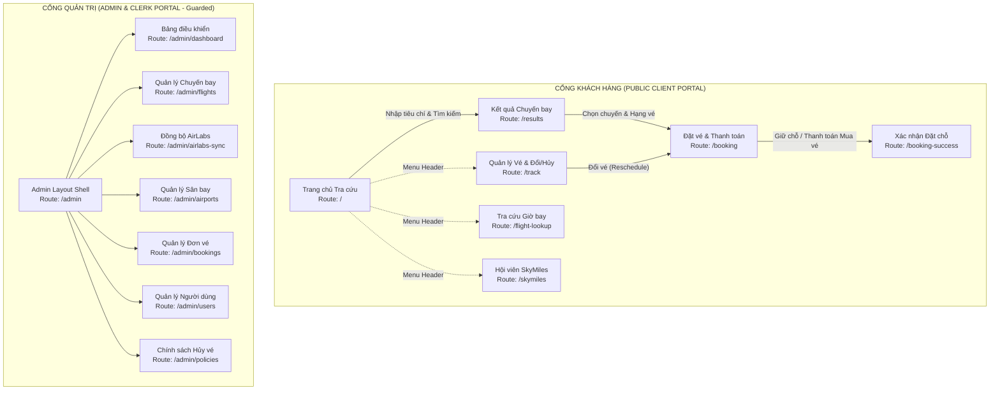

# TÀI LIỆU THIẾT KẾ GIAO DIỆN NGƯỜI DÙNG (INTERFACE DESIGN DOCUMENT)
**Hệ thống Quản lý và Đặt vé Máy bay (Airline Reservation System - ARS)**
**Mã tài liệu:** `docs/06-Interface-Design-Document.md`
**Dự án:** Aptech Airlines eProject
**Công nghệ:** Angular 21 (Standalone Components, Signals, Reactive Forms), Tailwind CSS v3, Lucide Icons

---

## 1. QUY CHUẨN THIẾT KẾ HỆ THỐNG (DESIGN SYSTEM & STANDARDS)

Toàn bộ giao diện của **Aptech Airlines** được xây dựng tuân thủ nghiêm ngặt theo tài liệu [GUI_Standards_Document.md](file:///C:/Users/Ha/Desktop/aptechairline/GUI_Standards_Document.md), định hình phong cách **Sang trọng Hàng không Hiện đại (Modern Aviation Luxury)** tương đương các hãng hàng không 5 sao quốc tế (Qatar Airways, Singapore Airlines, Vietnam Airlines).

### 1.1. Bảng màu Nhận diện & Ngữ thái (Color Tokens)
- **Aviation Navy (`#0A2540`):** Màu chủ đạo (Primary), thể hiện sự uy quyền, an toàn và chuyên nghiệp. Ứng dụng cho Header, Sidebar Admin, thanh điều hướng và tiêu đề cấp cao (`bg-[#0A2540]`, `text-[#0A2540]`).
- **Royal Gold (`#D4AF37` / Amber `#F59E0B`):** Màu điểm nhấn (Accent/CTA), tượng trưng cho dịch vụ cao cấp chuẩn 5 sao. Ứng dụng cho nút bấm hành động chính (Tìm kiếm, Đặt vé, Thanh toán), biểu tượng dặm bay SkyMiles và huy hiệu khoang Thương gia.
- **Ocean Slate (`#1E3A8A`):** Màu phụ trợ trạng thái hover trên nền tối (`bg-blue-900`).
- **Bảng màu Ngữ thái (Semantic Colors):**
  - *Ghế Thương gia / SkyBoss:* Vàng hoàng gia `#D4AF37` (Hàng 1 - 5).
  - *Ghế Khả dụng (Còn trống):* Xanh ngọc lục bảo `#10B981` (`bg-emerald-500`).
  - *Ghế Lối thoát hiểm:* Xanh da trời `#0284C7` (`bg-sky-600`) (Hàng 12 và 14).
  - *Ghế đang chọn:* Vàng phát sáng viền dày `#F59E0B` (`ring-4 ring-amber-400`).
  - *Ghế đã bán / Khóa:* Xám trung tính `#94A3B8` (`bg-slate-400`) kèm icon gạch chéo.
  - *Chuyến bay Hoãn giờ (`DELAYED`):* Hổ phách `#F59E0B` kèm lý do hoãn.
  - *Chuyến bay Hủy khẩn cấp (`CANCELLED`):* Đỏ cảnh báo `#EF4444` (`bg-red-500`).

### 1.2. Quy chuẩn Typography (Font chữ)
- **Phông chữ tiêu chuẩn:** **`Inter`** (Google Fonts) áp dụng trên 100% ứng dụng.
- **Đặc tính kỹ thuật:** Hỗ trợ hoàn hảo bộ ký tự tiếng Việt Unicode dựng sẵn; tỷ lệ x-height tối ưu giúp các con số (giờ bay, mã hiệu PNR, giá tiền, số ghế) hiển thị thẳng hàng, chống nhầm lẫn thị giác.
- **Thang cỡ chữ (Type Scale):**
  - *Hero / Display Title:* 36px - 44px (Font-black / Bold, Tracking-tight)
  - *Section Heading (H1 / H2):* 24px - 28px (Font-bold, Text-navy)
  - *Card Title (H3):* 18px - 20px (Font-semibold)
  - *Body Text (Nội dung thông thường):* 14px - 16px (Font-normal, Text-slate-600)
  - *Caption / Meta (Số hiệu, Ngày tháng, Badge):* 11px - 13px (Font-medium, Font-mono)

### 1.3. Kiểu dáng Thành phần (Button Shape & Components)
- **Nút bấm dạng viên thuốc (Pill-shaped Buttons):** Tất cả nút hành động tương tác chính đều áp dụng bo tròn tuyệt đối (`rounded-full`).
- **Hiệu ứng nâng khối (Micro-interactions & Shadow Lift):**
  - Trạng thái nghỉ: `shadow-md`
  - Trạng thái di chuột (Hover): `hover:-translate-y-0.5 hover:shadow-lg transition-all duration-200`
- **Thẻ hiển thị (Cards):** Nền trắng tinh khiết (`bg-white`), bo góc mềm mại `rounded-2xl` hoặc `rounded-3xl`, viền mảnh tinh tế `border border-slate-200/80`, bóng đổ nhẹ `shadow-sm`.

### 1.4. Bộ Biểu tượng Vector SVG & Cam kết Phi Emoji
- **Nguyên tắc cốt lõi:** **Tuyệt đối không sử dụng Emoji** trong giao diện để duy trì tính chuyên nghiệp của hệ thống hàng không.
- **Biểu tượng:** 100% Vector SVG thông qua thư viện `lucide-angular` (gồm các icon: `plane`, `armchair`, `calendar`, `clock`, `ticket`, `creditcard`, `users`, `shieldcheck`, `refreshcw`, `search`, `alerttriangle`,...).

### 1.5. Hỗ trợ Song ngữ Thời gian thực (Localization)
- Hỗ trợ chuyển đổi tức thì giữa **Tiếng Việt (`vi`)** (mặc định) và **Tiếng Anh (`en`)** qua `LanguageService` thông qua cơ chế Angular Signals mà không cần tải lại trang.

---

## 2. SƠ ĐỒ ĐIỀU HƯỚNG TỔNG THỂ (SITE MAP & ROUTE MAP)

Hệ thống được phân định thành 2 phân hệ độc lập: **Cổng Khách hàng (Client Portal)** công khai và **Cổng Quản trị (Admin & Clerk Console)** được bảo vệ bằng Guard xác thực phân quyền (`adminGuard`).

---

## 3. BẢNG ĐẶC TẢ MÀN HÌNH CỔNG KHÁCH HÀNG (CLIENT PORTAL)

### 3.1. Màn hình: Trang chủ & Hộp tìm kiếm (`HomeComponent` - Route: `/`)
- **Mục đích:** Giới thiệu thương hiệu Aptech Airlines, cung cấp công cụ tìm kiếm chuyến bay đa năng (Một chiều / Khứ hồi, điểm đi/đến, ngày bay đơn hoặc khoảng ngày, chọn số lượng Người lớn / Trẻ em / Người cao tuổi, chọn hạng vé và khoang hút thuốc).
- **Tập tin nguồn:** [home.component.ts](file:///C:/Users/Ha/Desktop/aptechairline/frontend/src/app/pages/home/home.component.ts)
- **API chính được gọi:** 
  - `GET /api/airports` (Tải danh mục sân bay phục vụ gợi ý tự động).
  - `GET /api/airports/resolve?city=...` (Kiểm tra tính hợp lệ của thành phố và gợi ý sân bay gần nhất).
- **Thành phần dùng chung:** `NavbarComponent`, `FooterComponent`, `AuthModalComponent`, `IconComponent`.
- **Bảng trạng thái giao diện:**
  | Trạng thái | Điều kiện kích hoạt | Biểu hiện giao diện người dùng |
  | :--- | :--- | :--- |
  | **Initial** | Vừa truy cập trang | Form tìm kiếm rỗng với mặc định: Khứ hồi, 1 Người lớn, Hạng Phổ thông. Nền ảnh hàng không cao cấp kèm hiệu ứng mờ kính. |
  | **Input Validating** | Người dùng nhập tên thành phố | Dropdown tự động hoàn thành hiển thị mã IATA và tên thành phố. Nếu chọn thành phố ngoại vệ không có đường bay thẳng, hộp thoại vàng hiển thị gợi ý sân bay gần nhất kèm số km đường bộ. |
  | **Validation Error** | Ngày về < Ngày đi hoặc thiếu điểm đi/đến | Báo đỏ viền input, nút tìm kiếm bị vô hiệu hóa, thông báo Toast cảnh báo lỗi logic ngày tháng. |
  | **Redirecting** | Bấm nút "Tìm kiếm chuyến bay" | Chuyển hướng sang `/results` kèm toàn bộ Query Parameters trên URL. |

---

### 3.2. Màn hình: Kết quả Tìm kiếm Chuyến bay (`FlightResultsComponent` - Route: `/results`)
- **Mục đích:** Hiển thị danh sách các chuyến bay khả dụng thỏa mãn điều kiện tìm kiếm. Trong trường hợp không có chuyến bay thẳng, tự động hiển thị các lựa chọn bay nối chuyến (Connecting flights qua trạm trung chuyển). Nếu tìm khứ hồi, hiển thị 2 bảng riêng biệt (Chiều đi và Chiều về) kèm lựa chọn hạng vé và xem giá chi tiết.
- **Tập tin nguồn:** [flight-results.component.ts](file:///C:/Users/Ha/Desktop/aptechairline/frontend/src/app/pages/flight-results/flight-results.component.ts)
- **API chính được gọi:** `GET /api/flights/search`
- **Thành phần dùng chung:** `NavbarComponent`, `FooterComponent`, `SeatMapModalComponent` (xem trước sơ đồ ghế), `ToastComponent`, `IconComponent`, `CurrencyFormatPipe`, `DurationPipe`.
- **Bảng trạng thái giao diện:**
  | Trạng thái | Điều kiện kích hoạt | Biểu hiện giao diện người dùng |
  | :--- | :--- | :--- |
  | **Loading** | Đang gọi API `/flights/search` | Khung Skeleton loading nhấp nháy mô phỏng hình thẻ chuyến bay. |
  | **Empty (Direct)** | Không có chuyến bay thẳng nào | Hiển thị hộp thông báo vàng: "Không có chuyến bay thẳng trực tiếp giữa 2 thành phố", tự động cuộn xuống khu vực "Gợi ý hành trình nối chuyến". |
  | **Empty (Total)** | Không có cả bay thẳng lẫn nối chuyến | Thẻ thông báo rỗng kèm icon máy bay màu xám: "Không tìm thấy chuyến bay phù hợp", kèm nút bấm "Quay lại tìm kiếm khác". |
  | **Error** | API lỗi mạng hoặc server trả về 500 | Banner cảnh báo đỏ nổi bật, hiển thị nút "Thử lại". |
  | **Success** | Có dữ liệu chuyến bay | Danh sách thẻ chuyến bay hiển thị rõ: Giờ đi/đến, thời gian bay, số hiệu, model máy bay, giá vé từng hạng (sau giảm giá trẻ em/cao tuổi), số ghế còn trống và nút "Chọn vé". |

---

### 3.3. Màn hình: Tiến trình Đặt vé & Thanh toán (`BookingComponent` - Route: `/booking`)
- **Mục đích:** Thu thập thông tin định danh của từng hành khách trong đoàn, chọn vị trí ghế ngồi trực quan qua sơ đồ máy bay tương tác, đối soát chi phí, chọn hình thức: **Giữ chỗ miễn phí** (chỉ cho phép khi ngày bay cách hiện tại > 14 ngày) hoặc **Mua vé ngay** (qua thẻ tín dụng).
- **Tập tin nguồn:** [booking.component.ts](file:///C:/Users/Ha/Desktop/aptechairline/frontend/src/app/pages/booking/booking.component.ts)
- **API chính được gọi:** 
  - `POST /api/bookings` (Tạo đơn giữ chỗ hoặc thanh toán mua vé).
  - `GET /api/flights/:id/seat-map` (Lấy sơ đồ ghế khả dụng thời gian thực).
- **Thành phần dùng chung:** `NavbarComponent`, `FooterComponent`, `SeatMapModalComponent`, `AuthModalComponent` (buộc đăng nhập trước khi hoàn tất giao dịch), `ToastComponent`, `IconComponent`.
- **Bảng trạng thái giao diện:**
  | Trạng thái | Điều kiện kích hoạt | Biểu hiện giao diện người dùng |
  | :--- | :--- | :--- |
  | **Initial Load** | Vừa vào từ trang kết quả | Tải thông tin chuyến bay đã chọn, tự động sinh các form nhập liệu hành khách tương ứng theo số lượng Người lớn, Trẻ em, Người cao tuổi. |
  | **Seat Map Active** | Bấm nút "Chọn ghế ngồi" | Mở modal sơ đồ ghế Airbus A321 để khách click gán mã ghế (VD: `12A`, `14B`) cho từng người. |
  | **Rule Blocking Gate** | Chuyến bay khởi hành trong vòng 14 ngày | Nút tùy chọn "Giữ chỗ" tự động bị khóa (disabled) kèm ghi chú: "Chuyến bay khởi hành trong vòng 14 ngày, chỉ được phép mua vé trực tiếp". |
  | **Submitting** | Đang gửi yêu cầu đặt chỗ/mua | Nút thanh toán chuyển sang trạng thái xoay vòng spinner (`loader2`), vô hiệu hóa click đúp. |
  | **Success** | Đặt/Mua thành công | Chuyển hướng sang trang `/booking-success` kèm mã PNR. |

---

### 3.4. Màn hình: Đặt vé Thành công (`BookingSuccessComponent` - Route: `/booking-success`)
- **Mục đích:** Thông báo kết quả giao dịch đặt vé thành công; hiển thị nổi bật Mã đặt chỗ (PNR), Mã giữ chỗ (`BLK-XXXXXX`) hoặc Mã xác nhận (`CNF-XXXXXX`), hạn chót thanh toán (nếu là vé giữ chỗ), tóm tắt hành trình và dặm bay SkyMiles đã tích lũy.
- **Tập tin nguồn:** [booking-success.component.ts](file:///C:/Users/Ha/Desktop/aptechairline/frontend/src/app/pages/booking-success/booking-success.component.ts)
- **API chính được gọi:** `GET /api/bookings/track/:code`
- **Thành phần dùng chung:** `NavbarComponent`, `FooterComponent`, `IconComponent`, `CurrencyFormatPipe`.
- **Bảng trạng thái giao diện:**
  | Trạng thái | Điều kiện kích hoạt | Biểu hiện giao diện người dùng |
  | :--- | :--- | :--- |
  | **Success (Confirmed)** | Khách hàng mua vé trả tiền ngay | Thẻ vé sang trọng viền vàng mạ, hiển thị mã `CNF-...`, trạng thái ĐÃ XÁC NHẬN, hiển thị số điểm SkyMiles được cộng, nút in vé và nút về trang chủ. |
  | **Success (Blocked)** | Khách hàng chọn giữ chỗ | Thẻ vé hiển thị mã `BLK-...`, trạng thái ĐANG GIỮ CHỖ, hộp cảnh báo màu vàng hiển thị Hạn chót thanh toán (đúng 2 tuần trước ngày bay) kèm thông báo hệ thống sẽ gửi email nhắc nhở trước 3 tuần. |

---

### 3.5. Màn hình: Quản lý Chuyến đi & Đổi/Hủy vé (`TrackBookingComponent` - Route: `/track`)
- **Mục đích:** Cho phép hành khách tra cứu hồ sơ chuyến bay bằng Mã giữ chỗ, Mã xác nhận hoặc Mã PNR. Cung cấp các chức năng tự phục vụ: **Xác nhận thanh toán vé giữ chỗ**, **Đổi ngày bay/chuyến bay (Reschedule)** kèm tính chênh lệch giá, và **Hủy vé (Cancel)** kèm tính % hoàn tiền tự động theo chính sách. Hiển thị cảnh báo nổi bật nếu chuyến bay bị trễ giờ hoặc hủy do thời tiết.
- **Tập tin nguồn:** [track-booking.component.ts](file:///C:/Users/Ha/Desktop/aptechairline/frontend/src/app/pages/track-booking/track-booking.component.ts)
- **API chính được gọi:** 
  - `GET /api/bookings/track/:code` (Tra cứu chi tiết).
  - `POST /api/bookings/confirm` (Xác nhận vé giữ chỗ).
  - `POST /api/bookings/reschedule` (Đổi vé).
  - `POST /api/bookings/cancel` (Hủy vé).
- **Thành phần dùng chung:** `NavbarComponent`, `FooterComponent`, `ToastComponent`, `IconComponent`, `CurrencyFormatPipe`.
- **Bảng trạng thái giao diện:**
  | Trạng thái | Điều kiện kích hoạt | Biểu hiện giao diện người dùng |
  | :--- | :--- | :--- |
  | **Search Bar** | Chưa tra cứu hoặc muốn tìm mã khác | Ô nhập mã vé với nút tìm kiếm dạng viên thuốc. |
  | **Emergency Alert** | Chuyến bay bị `DELAYED` hoặc `CANCELLED` | Khung thẻ đổi màu viền cam hoặc đỏ, hiển thị huy hiệu nhấp nháy kèm lý do cụ thể (VD: "Chuyến bay bị hủy do bão lớn tại Tân Sơn Nhất"). |
  | **Reschedule Modal** | Khách bấm "Đổi vé" | Cho phép chọn chuyến bay mới, hiển thị bảng tính số tiền chênh lệch cần phụ thu hoặc hoàn trả. |
  | **Cancel Modal** | Khách bấm "Hủy vé" | Tự động tính và hiển thị bảng % tiền hoàn lại theo ngày hủy, yêu cầu xác nhận trước khi thực thi. |

---

### 3.6. Màn hình: Cổng Hội viên SkyMiles (`SkyMilesComponent` - Route: `/skymiles`)
- **Mục đích:** Hiển thị tổng số điểm dặm bay tích lũy (`sky_miles`), thứ hạng thẻ hội viên (Bạc, Vàng, Bạch Kim), bảng đặc quyền và lịch sử các chuyến bay đã cộng/trừ dặm.
- **Tập tin nguồn:** [skymiles.component.ts](file:///C:/Users/Ha/Desktop/aptechairline/frontend/src/app/pages/skymiles/skymiles.component.ts)
- **API chính được gọi:** `GET /api/auth/me`, `GET /api/bookings?user_id=...`
- **Thành phần dùng chung:** `NavbarComponent`, `FooterComponent`, `AuthModalComponent`, `IconComponent`.
- **Bảng trạng thái giao diện:**
  | Trạng thái | Điều kiện kích hoạt | Biểu hiện giao diện người dùng |
  | :--- | :--- | :--- |
  | **Unauthenticated** | Khách chưa đăng nhập | Hiển thị thẻ giới thiệu chương trình bông sen vàng Aptech Airlines SkyMiles kèm nút "Đăng nhập / Đăng ký nhận dặm bay". |
  | **Authenticated** | Đã đăng nhập | Thẻ hội viên ảo mạ vàng sang trọng hiển thị Họ tên, Mã hội viên, Điểm dặm bay hiện có, Thanh tiến trình thăng hạng và Bảng danh sách cuống vé tích dặm. |

---

### 3.7. Màn hình: Tra cứu Lịch bay Công khai (`FlightLookupComponent` - Route: `/flight-lookup`)
- **Mục đích:** Phục vụ Yêu cầu 3.10: Cho phép bất kỳ người dùng nào (kể cả khách vãng lai chưa đăng nhập) tra cứu giờ cất cánh và hạ cánh của chuyến bay bất kỳ bằng cách nhập Số hiệu chuyến bay (VD: `VN101`) và Ngày bay.
- **Tập tin nguồn:** [flight-lookup.component.ts](file:///C:/Users/Ha/Desktop/aptechairline/frontend/src/app/pages/flight-lookup/flight-lookup.component.ts)
- **API chính được gọi:** `GET /api/flights/lookup?flight_number=...&date=...`
- **Thành phần dùng chung:** `NavbarComponent`, `FooterComponent`, `IconComponent`.
- **Bảng trạng thái giao diện:**
  | Trạng thái | Điều kiện kích hoạt | Biểu hiện giao diện người dùng |
  | :--- | :--- | :--- |
  | **Empty State** | Chưa tìm kiếm | Hướng dẫn hành khách nhập số hiệu chuyến bay và ngày khởi hành. |
  | **Loading** | Đang truy vấn | Biểu tượng spinner xoay tròn trên nút tra cứu. |
  | **Not Found** | Không có chuyến bay với số hiệu/ngày đó | Thẻ thông báo nhẹ nhàng: "Không tìm thấy thông tin chuyến bay tương ứng trong lịch trình". |
  | **Success** | Tìm thấy chuyến bay | Hiển thị thẻ giờ bay chi tiết: Giờ cất cánh/hạ cánh theo lịch trình, giờ thực tế (nếu có), thời gian bay, trạng thái chuyến bay (Đúng giờ, Chậm chuyến kèm số phút, hoặc Hủy chuyến). |

---

## 4. BẢNG ĐẶC TẢ MÀN HÌNH CỔNG QUẢN TRỊ (ADMIN & CLERK PORTAL - `/admin`)

Cổng quản trị sử dụng khung giao diện chung `AdminLayoutComponent` với **Sidebar màu Xanh Navy Tối (`#0A2540`)** cố định bên trái và thanh tiêu đề Top Header phía trên.

### 4.1. Bảng tổng hợp 7 Màn hình Quản trị

| Đường dẫn (Route) | Tên Component | Mục đích nghiệp vụ | API chính gọi | Các trạng thái giao diện |
| :--- | :--- | :--- | :--- | :--- |
| `/admin/dashboard` | `DashboardComponent` | Báo cáo trực quan tổng số chuyến bay, đơn đặt vé, doanh thu, hành khách và trạng thái chuyến bay hôm nay. | `GET /api/flights`, `GET /api/bookings`, `GET /api/users` | Loading spinner ➔ Dashboard thẻ số liệu KPI ➔ Biểu đồ phân bổ trạng thái chuyến bay. |
| `/admin/flights` | `FlightsManageComponent` | Quản trị toàn diện chuyến bay (Thêm mới, Sửa lịch, Xóa, Cấu hình khoang vé & giá) và cập nhật khẩn cấp trạng thái DELAYED/CANCELLED do thời tiết xấu (Yêu cầu 1.2.3). | `GET /api/flights`, `POST /api/flights`, `PUT /api/flights/:id`, `PATCH /api/flights/:id/status`, `DELETE /api/flights/:id` | Bảng dữ liệu có tìm kiếm/lọc ➔ Modal tạo/sửa chuyến ➔ Modal cập nhật khẩn cấp thời tiết ➔ Tự động lan truyền hủy vé. |
| `/admin/airlabs-sync` | `AirlabsSyncComponent` | Đồng bộ lịch bay thực tế từ API Hàng không quốc tế AirLabs theo chặng bay (HAN - SGN); làm giàu số đăng bạ tàu bay đang bay thực tế; tra cứu đội bay hãng. | `POST /api/flights/sync-airlabs`, `POST /api/flights/enrich-airborne`, `GET /api/flights/airline-fleet` | Input chọn sân bay đi/đến ➔ Nút đồng bộ có đếm số chuyến thành công ➔ Radar theo dõi tàu bay trên không ➔ Fallback trung thực. |
| `/admin/airports` | `AirportsManageComponent` | Quản lý danh mục sân bay, thành phố, múi giờ, cờ đường bay trực tiếp (`is_serviced_directly`) và cấu hình sân bay lân cận cùng khoảng cách km. | `GET /api/airports`, `POST /api/airports`, `PUT /api/airports/:iata`, `DELETE /api/airports/:iata` | Bảng danh sách sân bay ➔ Form thêm/sửa có kiểm tra trùng mã IATA ➔ Thông báo xóa thành công. |
| `/admin/bookings` | `BookingsManageComponent` | Quản lý toàn bộ hồ sơ đặt chỗ (PNR); lọc theo trạng thái BLOCKED, CONFIRMED, CANCELLED; kích hoạt quét gửi thư nhắc nhở 3 tuần hoặc kích hoạt hủy vé quá hạn thủ công. | `GET /api/bookings`, `POST /api/bookings/trigger-reminders`, `POST /api/bookings/trigger-autocancel` | Danh sách đơn vé kèm chip trạng thái màu ➔ Nút kích hoạt Cron thủ công ➔ Modal xem chi tiết hành khách và cuống vé. |
| `/admin/users` | `UsersManageComponent` | Quản lý danh sách người dùng, tạo tài khoản Clerk/Admin; thực thi quy tắc nghiêm ngặt: **Bảo vệ tài khoản SUPER_ADMIN duy nhất** (chặn xóa, chặn đổi quyền, chặn tạo thêm). | `GET /api/users`, `POST /api/users`, `PUT /api/users/:id`, `DELETE /api/users/:id` | Bảng người dùng có phân loại role ➔ Khóa thao tác xóa trên dòng `SUPER_ADMIN` ➔ Báo lỗi 403 Forbidden nếu cố tình vi phạm. |
| `/admin/policies` | `PoliciesManageComponent` | Cấu hình linh hoạt bảng quy tắc % hoàn tiền khi hủy vé theo số ngày trước giờ bay (min_days_before, max_days_before, refund_percentage). | `GET /api/policies`, `POST /api/policies`, `PUT /api/policies/:id`, `DELETE /api/policies/:id` | Bảng quy tắc hoàn tiền theo thứ tự ngày giảm dần ➔ Form thêm/sửa mốc ngày và % hoàn trả. |

---

## 5. ĐẶC TẢ CÁC THÀNH PHẦN DÙNG CHUNG (SHARED COMPONENTS)

### 5.1. `NavbarComponent`
- **Vị trí:** Cố định trên đầu mọi trang Cổng Khách hàng.
- **Chức năng:**
  - Hiển thị Logo Aptech Airlines với biểu tượng máy bay mạ vàng và Typography sang trọng.
  - Menu điều hướng: *Tra cứu chuyến bay, Quản lý chuyến bay (Đổi/Hủy vé), Lịch bay (Yêu cầu 3.10), SkyMiles, Cổng Quản trị (hiện khi có role CLERK/ADMIN/SUPER_ADMIN)*.
  - Bộ chuyển đổi ngôn ngữ Song ngữ Tiếng Việt / Tiếng Anh (`VI | EN`) phản hồi tức thì.
  - Khối tài khoản người dùng: Nếu chưa đăng nhập hiển thị nút "Đăng nhập / Đăng ký"; nếu đã đăng nhập hiển thị Họ tên, Điểm SkyMiles và Menu đăng xuất.

### 5.2. `FooterComponent`
- **Vị trí:** Chân trang trên mọi màn hình Cổng Khách hàng.
- **Chức năng:**
  - Thông tin định vị thương hiệu: *"Bay đến tương lai - Tiện nghi chuẩn 5 sao"*.
  - Liên kết tiện ích tra cứu nhanh, mạng lưới sân bay, điều khoản dịch vụ và chính sách bảo mật hành khách.
  - Bản quyền đồ án eProject Aptech Airlines 2026.

### 5.3. `SeatMapModalComponent`
- **Vị trí:** Cửa sổ Modal bật lên từ trang Đặt vé (`/booking`) hoặc trang Kết quả (`/results`).
- **Chức năng:**
  - Hiển thị mô phỏng thân tàu bay **Airbus A321** chuẩn quốc tế gồm 31 hàng ghế theo cấu hình 3 - 3.
  - Cơ chế chọn ghế thông minh: Hỗ trợ chọn và đổi ghế cho từng hành khách trong đoàn bay với bộ chọn hành khách ở cột bên trái.
  - Phân loại trực quan: Hàng ghế Đặc biệt (Hàng 1 - 5), Hàng ghế gần Lối thoát hiểm (Hàng 12, 14), và **loại trừ hàng 13**.
  - Hiển thị cảnh báo tiêu chuẩn quốc tế về điều kiện sức khỏe đối với hành khách ngồi hàng ghế thoát hiểm.

### 5.4. `AuthModalComponent`
- **Vị trí:** Hộp thoại toàn cục bật lên khi khách bấm Đăng nhập hoặc khi chuẩn bị hoàn tất đặt vé.
- **Chức năng:**
  - Hỗ trợ chuyển đổi mượt mà giữa 2 tab: **Đăng nhập** và **Đăng ký tài khoản mới**.
  - Form đăng ký thu thập đầy đủ các trường theo Yêu cầu 3.2: *Username, Password, First name, Last name, Email, Phone number, Address, Sex, Age, Preferred Credit Card*, và tự động khởi tạo `sky_miles = 0`.
  - Lưu trữ JWT Token vào `localStorage` và cập nhật Signal trong `AuthService`.

### 5.5. `ToastComponent` & `ToastService`
- **Vị trí:** Cố định góc trên bên phải màn hình (`fixed top-5 right-5 z-50`).
- **Chức năng:**
  - Hiển thị các thông báo phản hồi thao tác tức thì với 4 cấp độ: `success` (Xanh lá), `error` (Đỏ), `warning` (Hổ phách), `info` (Xanh dương).
  - Tự động ẩn sau 4000ms kèm hiệu ứng trượt mượt mà.

### 5.6. `IconComponent`
- **Vị trí:** Thành phần nhúng biểu tượng trên toàn hệ thống.
- **Chức năng:**
  - Tích hợp động với thư viện vector SVG `lucide-angular`.
  - Nhận tham số `name` (VD: `plane`, `armchair`, `users`, `ticket`) và kế thừa màu chữ/kích thước từ Tailwind CSS của phần tử cha. Tuyệt đối không sinh mã Emoji.
